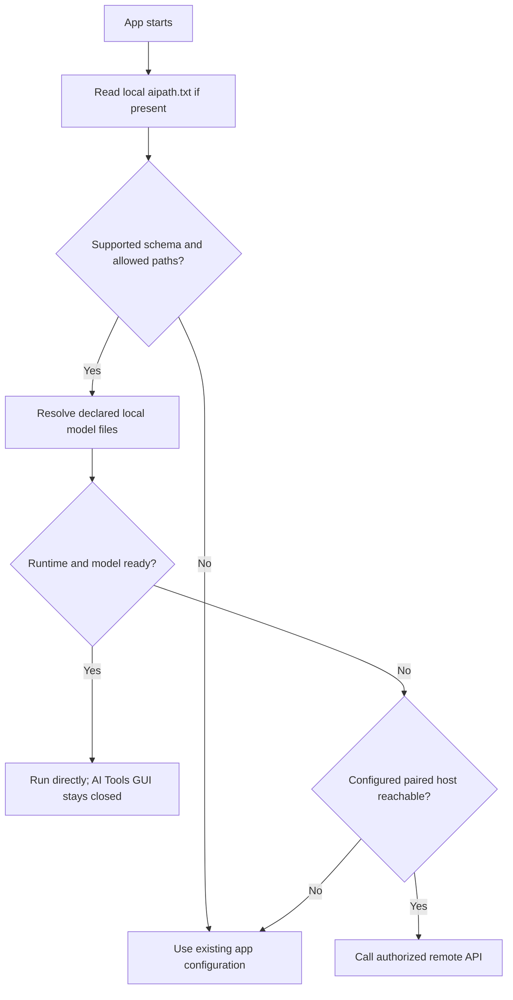

# Proposed `aipath.txt` compatibility bridge

> **Design draft, NOT an existing deployed configuration file.** No TIHULU applications have been changed by this document.

## Goals

- The AI Tools **GUI can be closed** while a client reads valid model paths and continues working.
- A client must not require the manager daemon merely to resolve a local model path.
- Keep legacy app configuration as the fallback until a compatible adapter is implemented and verified.
- Never put credentials, executable commands, or untrusted relative path traversal in this file.
- Allow each app to explicitly select local managed library, external/Jan-owned model, or a paired inference host.

## Illustrative v1 INI-compatible text file

```ini
schema=1
app_id=tihulu-survival-kit
manager_mode=optional
compute_preference=remote-first
model_root=~/TIHULU AI Tools/Models
remote_host_id=paired-pc-01
fallback=legacy
```

These are **proposed keys**, not a final parser grammar. Model/task mappings should reference stable registry IDs in a companion manifest rather than assuming every engine consumes the same binary file format. A remote host ID is only a **non-secret reference** to a separately paired and authenticated endpoint.

## Startup resolution contract



## Safe relocation sequence

1. Inventory model consumers and paths; reject out-of-scope paths or unauthorized directories.
2. User selects link-in-place, managed copy, or safe move with destination preview.
3. Stop only owned jobs when necessary; never silently stop Jan, Ollama, readsb, or other unrelated processes.
4. Stage target, preserve original, verify checksums and free space.
5. Update only approved mappings via atomic write and backup; run a consumer smoke test.
6. On any failure, revert mappings and retain originals; deletion is a **separate explicit approval**.
7. Keep per-app fallback and rollback records.

## Security and UX

- Files are local user-controlled configuration; explicit scopes determine whether manager can edit app folders.
- Reject symlink path escape, arbitrary script/command fields and untrusted remote URLs.
- Remote server credentials belong in an OS vault; `aipath.txt` only stores a host reference.
- Detect conflicts and warn when multiple apps depend on the same model or when a model is in active use.
- EN/TR/DE UI strings must clearly distinguish **Available locally**, **Referenced externally**, **Ready to run**, **Remote host unavailable**, and **Needs compatible runtime**.

See [architecture](ARCHITECTURE.md) and [decisions](DECISIONS.md).
