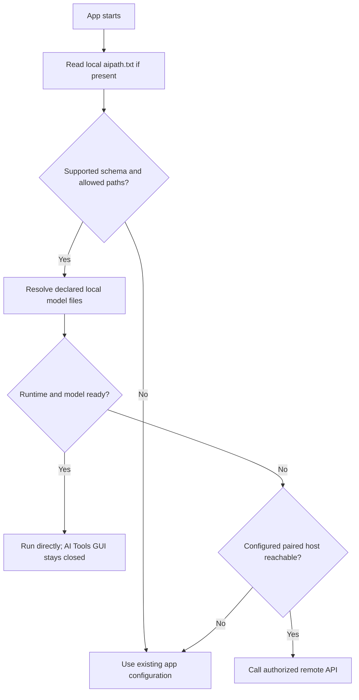

# Proposed `aipath.txt` compatibility bridge

> **Design draft, NOT an existing deployed configuration file.** No TIHULU applications have been changed by this document.

## Goals

- The AI Tools **GUI can be closed** while a client reads valid model paths and continues working.
- A client must not require the manager daemon merely to resolve a local model path.
- Keep legacy app configuration as the fallback until a compatible adapter is implemented and verified.
- Never put credentials, executable commands, or untrusted relative path traversal in this file.
- Allow each app to explicitly select local managed library, external/Jan-owned model, or a paired inference host.

## Illustrative v1 INI-compatible text file

```ini
schema=1
app_id=tihulu-survival-kit
manager_mode=optional
compute_preference=remote-first
model_root=~/TIHULU AI Tools/Models
remote_host_id=paired-pc-01
fallback=legacy
```

These are **proposed keys**, not a final parser grammar. Model/task mappings should reference stable registry IDs in a companion manifest rather than assuming every engine consumes the same binary file format. A remote host ID is only a **non-secret reference** to a separately paired and authenticated endpoint.

## v0.5 remote host assignment (proposed)

On Raspberry Pi, the **same paired PC GPU host** can be selected for AI Tools' own Advisor/Agent and assigned to each independent TIHULU application's individual AI task.

- `remote_host_id` in a local `aipath.txt` is a **non-secret reference**. Host address, device identity and secret credentials are resolved from an owner-approved local pairing registry; secrets stay in OS-managed secret storage.
- The PC resolves a stable **host-owned model ID**, not a Raspberry Pi filesystem path.
- Proposed per-task routing is `auto`, `local-first`, `remote-first` or `remote-only`; actual v2 key syntax remains under design.
- GUI closure does **not** block apps from starting, and does not terminate an explicitly running dedicated host service. Without a host, unaffected non-AI features continue.
- Remote model outputs do not authorize local agent actions. An independent Rust permission gate must enforce all app tools on the side where the action runs.

Possible future manifest (illustrative only, **not** valid v1 parser syntax):

```ini
# v2 proposal — do not insert these keys in a production client yet
task.llm.compute=remote-first
task.llm.remote_host_id=paired-pc-01
task.llm.model_id=host-owned-verified-llm
task.speech.compute=local-first
```

## Startup resolution contract



## Safe relocation sequence

1. Inventory model consumers and paths; reject out-of-scope paths or unauthorized directories.
2. User selects link-in-place, managed copy, or safe move with destination preview.
3. Stop only owned jobs when necessary; never silently stop Jan, Ollama, readsb, or other unrelated processes.
4. Stage target, preserve original, verify checksums and free space.
5. Update only approved mappings via atomic write and backup; run a consumer smoke test.
6. On any failure, revert mappings and retain originals; deletion is a **separate explicit approval**.
7. Keep per-app fallback and rollback records.

## Security and UX

- Files are local user-controlled configuration; explicit scopes determine whether manager can edit app folders.
- Reject symlink path escape, arbitrary script/command fields and untrusted remote URLs.
- Remote server credentials belong in an OS vault; `aipath.txt` only stores a host reference.
- Detect conflicts and warn when multiple apps depend on the same model or when a model is in active use.
- EN/TR/DE UI strings must clearly distinguish **Available locally**, **Referenced externally**, **Ready to run**, **Remote host unavailable**, and **Needs compatible runtime**.

See [architecture](ARCHITECTURE.md) and [decisions](DECISIONS.md).


## v0.6 external model references and task-level matching (proposal)

When TIHULU AI Tools discovers a model in **Jan or another application**, it may register a user-approved reference **without** moving the source file or modifying Jan's configuration. An eligible TIHULU consumer may then select that reference per supported AI task. Binding **the consumer** is separate from repointing **the model owner**.

Example proposed *future* mapping, not a standardized v1 parser:

```ini
schema=2-proposal
app_id=tihulu-survival-kit
manager_mode=optional
task.llm.model_ref=external:jan:stable-model-id
task.llm.compute=local-first
task.llm.runtime=llama.cpp
fallback=legacy
```

Interpretation: `external:jan:stable-model-id` resolves via a **locally cached and user-owned private model registry** to either (a) an authorized model file referenced in place and a verified runtime, or (b) an approved inference endpoint. The app must not assume that a Jan model appears in `~/TIHULU AI Tools/Models`.

### Independence when GUI or third-party owner is closed

- The *GUI* may be closed: client reads a persistent valid local manifest/registry reference or legacy configuration.
- A **direct file reference** may remain usable with a compatible separately installed runtime even if Jan is closed, subject to file availability and owner control.
- A **Jan inference server endpoint** requires that Jan (or its independently managed server) is running. Never silently start or stop Jan.
- A **paired PC host** requires a securely paired, reachable host service. It uses its *own* model registry and validates task/model IDs; paths on Pi are not interpreted on PC.
- Missing external files, broken references, revoked access and version changes should produce per-task errors with legacy fallback; never stop unrelated features.

### Future permissions

Scanning a foreign model directory permits **read-only discovery**, not editing its files. A user-initiated model-to-app mapping may write **only** the target app's pre-approved configuration, using atomic updates, backup, compatibility test and rollback. Moving a model managed by Jan or another application requires a supported owner-native relocation operation or a clearly verified multi-app migration with a separate cleanup confirmation.

Never put secrets or raw provider access tokens in `aipath.txt`. Both application path and model reference must be validated against owner-granted scopes. The matching LLM must not generate a writable path that bypasses Rust-side validation.

See [discovery and matching](MODEL_DISCOVERY_AND_MATCHING.md) and [Jan integration](JAN_INTEGRATION.md).
