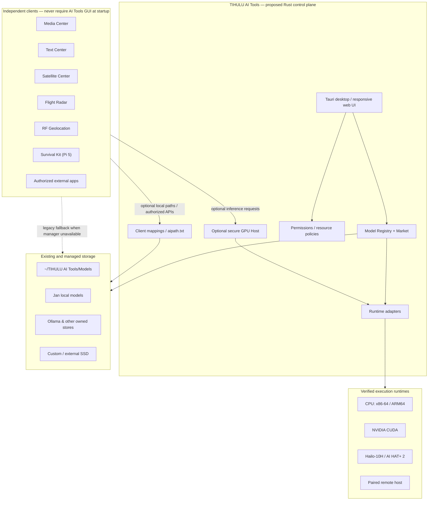
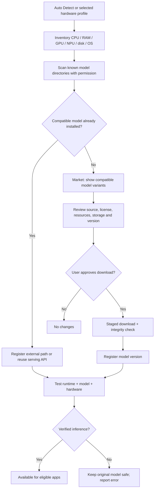
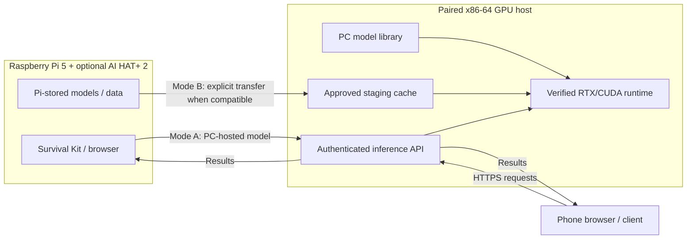
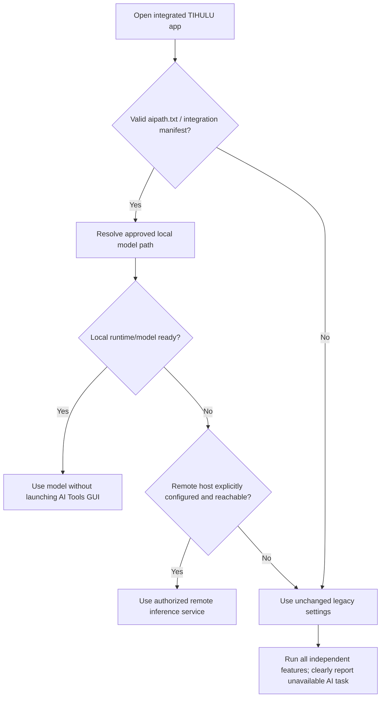
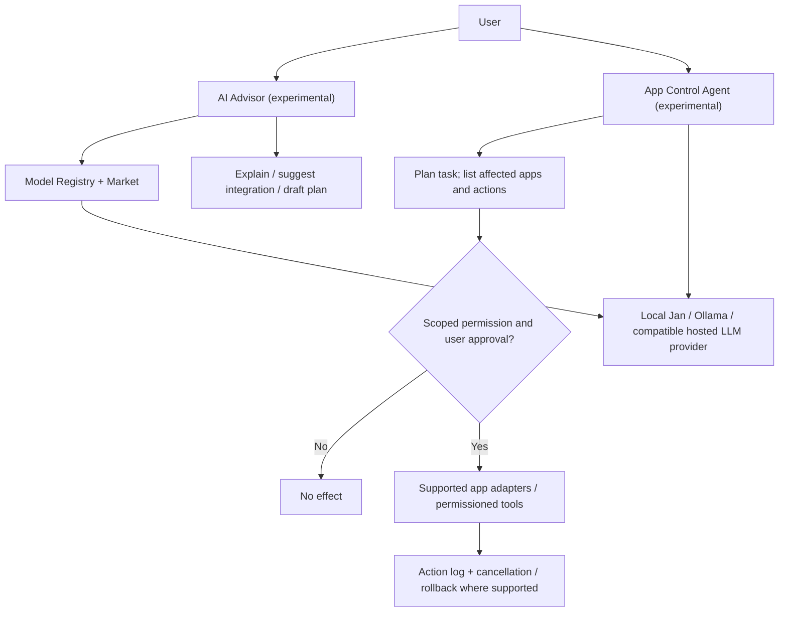
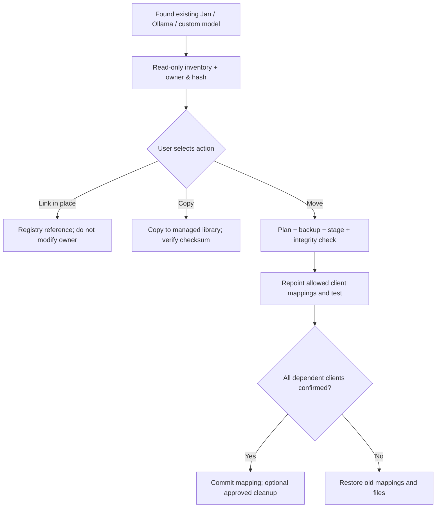

# Architecture diagrams — planning baseline v0.5

**Status:** Design diagrams, not a deployed architecture. These Mermaid diagrams are the text-editable reference for future discussions and reviews. They render in GitHub Markdown.

## A. System boundaries

## B. Hardware-aware model discovery and installation

## C. GPU Server: two distinct modes

A phone opening the web UI is **a client**, not automatically a GPU server. A Pi model cannot run on NVIDIA simply because it exists: the model artifact must be supported by the PC runtime. Hailo HEF and CUDA models are not interchangeable.

## D. Application startup: GUI must not be required

## E. Experimental LLM modules and permissions

**Security baseline:** no Internet access or unscoped agent execution by default; credentials only in OS secret storage; no tokens in `aipath.txt`. Raw llama.cpp RPC is not an acceptable unauthenticated public endpoint.

## F. Storage and path portability

## G. Raspberry Pi AI Tools uses the paired PC GPU

\`\`\`mermaid
flowchart TB
  subgraph PI["Raspberry Pi 5 · Rust AI Tools client"]
    CHAT["AI Advisor / Agent chats"]
    APPS["Survival Kit & independent TIHULU apps"]
    ROUTE["Rust task routing and permission policy"]
    MAP["Per-app aipath.txt + paired host registry"]
    CHAT --> ROUTE
    APPS --> MAP
    MAP --> ROUTE
  end
  subgraph PC["PC · Rust AI Tools GPU host"]
    HOST["Authenticated Rust host service"]
    MODELS["PC model registry (Jan / Ollama / managed)"]
    GPU["Verified CUDA / CPU inference adapter"]
    HOST --> MODELS
    HOST --> GPU
  end
  ROUTE <-->|"TLS: Ethernet, LAN or VPN"| HOST
  ROUTE -->|"Independent approval gate"| ACTION["Local permitted app tools"]
\`\`\`

The Pi can use the same paired PC host for AI Tools' **own** chat inference and for individually authorized applications. Model weights may remain on PC. The GUI is not required at application startup; remote jobs require a reachable host service.

## H. Feature-level inference routing

\`\`\`mermaid
flowchart TD
  R["AI Tools feature or app AI request"] --> PREF["Auto / This device / Paired GPU"]
  PREF --> L{"Compatible local runtime?"}
  L -->|"Local chosen and compatible"| LOCAL["Run locally"]
  L -->|"Remote chosen / approved fallback"| P{"Paired host authorized + reachable + compatible?"}
  P -->|Yes| HOST["Run on PC GPU; show host/model + queue status"]
  P -->|No| FAIL["Report AI task unavailable; app stays usable"]
  LOCAL --> OUTPUT["Return result with origin"]
  HOST --> OUTPUT
  HOST --> POLICY["Quota, cancellation, and audit"]
\`\`\`

## I. Chat agents share routing, not tool privileges

\`\`\`mermaid
flowchart LR
  ADVISOR["Advisor conversation"] --> ROUTER["Rust inference router"]
  AGENT["App Agent conversation"] --> ROUTER
  ROUTER --> LOCAL["Local compatible LLM"]
  ROUTER --> PC["Paired PC GPU"]
  AGENT --> GATE{"Scoped tool permission and user approval"}
  GATE -->|Yes| APP["Approved app adapter"]
  GATE -->|No| DENY["No app action"]
\`\`\`

## Related specifications

- [Full product plan](TIHULU_AI_TOOLS_PLAN.md)
- [Proposed aipath compatibility contract](AIPATH_CONTRACT.md)
- [Decisions and phase gates](DECISIONS.md)
- [Interactive mockup (non-functional)](../ui/index.html)
