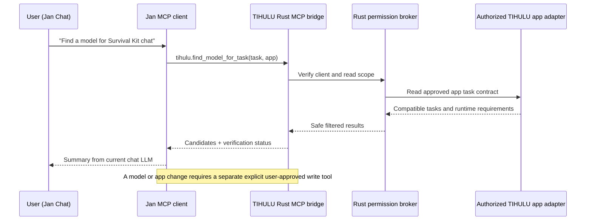

# Optional Jan Integration — v0.6 architecture proposal

> **Status:** Planning only. Jan and TIHULU AI Tools are not presently integrated. A future **TIHULU MCP Server** should be implemented in Rust and offered as an optional integration, not installed or enabled without user approval.

## 1. Two distinct Jan products

### Jan Desktop — preferred first integration

Current Jan Desktop supports **MCP (Model Context Protocol)** clients via Settings → MCP Servers, with local **STDIO**, **Streamable HTTP** and **SSE** transports. A model in a Jan chat can call the tools exposed by an approved MCP server. Jan's MCP tool permission settings should **not** be globally changed to auto-approve requests by TIHULU.

The preferred first deliverable is not an undocumented modification to Jan internals or a mandatory Jan-specific binary plugin. It is a generic **Rust TIHULU MCP Server**, plus an optional Jan-friendly connection preset/instructions, that exposes narrowly scoped TIHULU capabilities.

### Jan Agent — optional second package

Standalone Jan Agent supports repository-installed plugins built from skills, commands, agents, `plugin.toml` and optional MCP declarations/tools. An optional **TIHULU for Jan Agent** plugin can provide guided installation and instructions for attaching the same TIHULU MCP Server. Installation must never start a server or import credentials without approval. Jan Agent is separate from Jan Desktop.

Reference:
- https://docs.jan.ai/desktop/integrations/mcp-servers
- https://docs.jan.ai/agent/plugins

## 2. Proposed user flow

1. Open **TIHULU AI Tools → External Apps → Jan**.
2. Select **Discover Jan models**. Approve read-only scan of Jan's detected data folder, or choose a custom folder.
3. Inspect discovered **Jan-managed GGUF/MLX** artifacts, models on Jan's local API endpoint, or both; add safe external references to **My Models** without moving/copying weights.
4. Select **Enable Jan Chat Tools** (optional). Preview which TIHULU capabilities will be exposed through Rust MCP server, and grant exact apps and actions.
5. Connect Jan Desktop to that local MCP server using its documented Settings → MCP Servers connection flow. Use an explicit owner-approved STDIO command or loopback/secure authenticated HTTP endpoint. No public listening address by default.
6. In Jan chat, the user asks e.g., “Show me which Satellite Center passes are scheduled” or “Transcribe this selected Media Center recording.” Jan requests a named MCP tool from TIHULU; Rust checks app adapter availability, authorization and active-device constraints, then returns actual results/errors.
7. Jan may compose a natural-language answer, but the **TIHULU authorization layer**, not Jan or the LLM, decides whether each tool operation is allowed.

## 3. Candidate MCP tools (illustrative only)

| Tool name | Planned function | Typical permission |
| --- | --- | --- |
| `tihulu.list_apps` | Enumerate installed and explicitly registered TIHULU apps and declared capabilities | Read-only |
| `tihulu.list_models` | Return redacted registered model metadata and actual available task kinds | Read-only |
| `tihulu.find_model_for_task` | Get compatible model candidates with evidence / validation status | Read-only |
| `tihulu.get_app_status` | Query approved app task/receiver status, avoid private raw logs | Read-only |
| `tihulu.get_satellite_passes` | Call a supported Satellite Center planner API if implemented | Read-only |
| `tihulu.preview_model_binding` | Preview proposed `aipath.txt` and adapter configuration diff | Read-only |
| `tihulu.request_model_binding` | Apply a user-approved, adapter-validated change with rollback | Explicit write approval |
| `tihulu.request_media_task` | Queue a verified app task, e.g. recording transcription, with input scope | Explicit execution/data approval |
| `tihulu.cancel_owned_job` | Cancel only an authorized job associated with this client | Scoped execution |

This is **not** a claim that any of these capabilities or Jan integration exist yet. Expose a tool only when the relevant independently developed TIHULU application actually implements it and the owner enables it.

Avoid a generic `run_command`, `write_any_file`, shell, direct SDR tuning, arbitrary USB control, or unrestricted execution tool.

## 4. Tool-call chain

## 5. Model and GPU host interplay

- **Jan model discovery:** Jan file stored locally → external registry reference; do not move or patch Jan metadata.
- **Jan as inference endpoint:** Jan's local OpenAI-compatible server, when started and authorized, may serve TIHULU clients; model remains owned by Jan. Local server may require Jan to be running.
- **TIHULU as inference endpoint:** A verified TIHULU host (including paired PC GPU) can potentially be offered to Jan via supported OpenAI-compatible endpoint configuration, independently from MCP tools; verify capabilities/model/tool-calling separately.
- **Jan as MCP client:** Jan chat can ask TIHULU to invoke an *app tool*; this is separate from which GPU executes Jan's LLM. An MCP tool does not automatically gain GPU or machine permissions.
- All remote requests need explicit pairing, authentication, consent for data leaving device, resource quotas, per-tool approval and auditability.
- Failure in Jan or host should not prevent TIHULU apps from opening or using their local fallback paths.

## 6. Optional Jan integration surfaces in UI

**External Apps → Jan**:
- Find application installation and selected **Jan Data Folder** (or provide custom path)
- **Discover existing models** with visible read-only consent, show `source=Jan`
- **Use model in TIHULU task** with verified runtime or Jan inference endpoint; preview mapping
- **Offer TIHULU tools to Jan Chat** toggle **OFF by default**
- **Connect to Jan** shows MCP connection instructions; no silent edits to Jan config
- Tool permission table per TIHULU application; grant/revoke and audit
- Optional **Jan Agent plugin** is a separate package to be planned and tested after core MCP server
- Test with Jan version pinned and selected compatible model; display unsupported tool-calling clearly.

## 7. Security & versioning

Jan owns its data folder, even if configured outside defaults. Scan only granted areas; never read threads, prompts, logs, credentials, agent memory or unrelated files during model discovery. Avoid exposing absolute paths to cloud LLM providers by default. Treat tool arguments and LLM outputs as untrusted. Every write or action must be handled by an explicitly authorized Rust adapter and audited. Do not auto-enable Jan's global **Allow All MCP Tool Permissions** option.

Jan Desktop and Jan Agent versions may differ; a release matrix and smoke tests are mandatory. No compatibility claim is made without exercising the specific Jan version, selected model and TIHULU MCP server.

## 8. Evidence references

- [Jan Desktop: MCP Servers](https://docs.jan.ai/desktop/integrations/mcp-servers)
- [Jan Agent: Plugins](https://docs.jan.ai/agent/plugins)
- [Jan Desktop: Data Folder](https://docs.jan.ai/desktop/data-folder)
- [Jan Desktop: Model Management](https://docs.jan.ai/desktop/manage-models)
- [Jan Desktop: Local API Server](https://jan.ai/docs/api-server)
