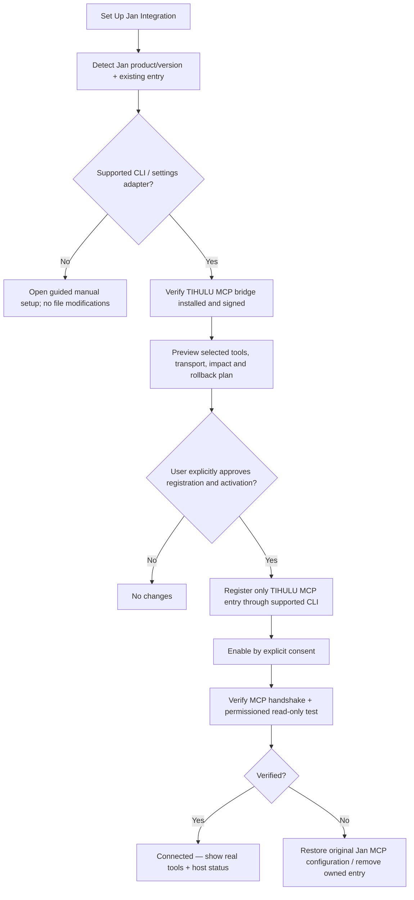

# Jan Connection Wizard — In-App Guide and One-Click Setup

> **Status: Approved product requirement, proposed implementation (v0.7 planning).** No Jan configuration or TIHULU MCP server is installed today. The HTML preview only simulates the wizard. Do not claim a completed connection until a real MCP handshake and authorized tool call succeed.

## Goal

In **TIHULU AI Tools → External Apps → Jan**, provide both a **How to connect Jan** step-by-step in-app guide and a prominent **Set Up Jan Integration** button. The button will perform the supported installation, registration, verification and activation steps *after* the owner sees the plan and explicitly grants access. It must be reversible, idempotent and safe for the existing Jan installation.

An experienced user should need no manual JSON editing. When installed Jan versions or packaging do not expose a supported automated configuration mechanism, **fall back to guided manual setup**; do not directly patch Jan's application data files while it is active.

## Proposed UI

- **Jan Desktop** / **Jan Agent** selector, and detected product version/installation path (or **Choose Jan folder**).
- **Connection status**: Not configured / Jan found / Preparing / Needs approval / Configured but disabled / Connected and verified / Unavailable / Failed and rolled back.
- **Tool selection:** model/app inventory (read-only by default), approved TIHULU app status, narrowly scoped task invocation (off until individually granted). No generic shell.
- **Transport:** local **STDIO** by default, optionally authenticated **Streamable HTTP** for explicitly paired remote hosts; no unauthenticated network exposure.
- Buttons: **How to connect** (expand guide), **Set Up Jan Integration** (permission review + action), **Test Connection**, **Open Jan MCP Settings**, **Disconnect / Undo Setup**, **Copy Manual Steps**.
- A progress/log area explaining real status, current task and any required Jan-side action. Never show a green “Connected” until Jan sees and can invoke the approved tools.
- No password, bearer token, API key or private Jan chat content in logs, copied guides or model files.

## Guided installation — five stages

1. **Detect Jan:** inspect only approved installation metadata or use Jan's supported CLI. Distinguish Jan Desktop from Jan Agent; versions may differ. Query current installed MCP names to avoid duplicates.
2. **Prepare TIHULU bridge:** verify the **Rust TIHULU MCP Server** is installed or offer a signed, version-pinned, owner-approved installation (only in the future implementation phase). Choose app capabilities and least privilege. No process is launched in this planning stage.
3. **Review permissions:** display tool names, target TIHULU apps, local/remote transport, what operations can be read/written and whether data can leave this device. Read-only default. Tool writes/remote inference need separate explicit approvals. Keep Jan's global **Allow All MCP Tool Permissions** unchanged, ideally OFF.
4. **Configure safely:** where supported and version-verified, use the Jan CLI's documented MCP management API rather than editing the raw `mcp_config.json` file. Jan's currently documented commands include `jan cli mcp list`, `jan cli mcp add`, `jan cli mcp enable`, `jan cli mcp disable`, `jan cli mcp remove`. The future Rust bridge executable/arguments must be real and must be verified before constructing the command. Add inactive unless user explicitly selects Enable. If the CLI is unavailable, show Jan Desktop → **Settings → MCP Servers → Add MCP Server**, transport and generated command/URL values for the user to apply.
5. **Verify and optionally enable:** check that Jan lists the connection, the MCP initialize handshake and safe tool listing work, and the chosen Jan chat model has tools enabled. Perform a read-only smoke call with user consent. Display actual results or precise failure; offer rollback of only the TIHULU-created MCP entry.

## Expected primary-button flow

The button is a **workflow**, not carte blanche for a model to execute shell commands or write arbitrary files. The final user approval is required before actual registration/activation. Subsequent per-tool Jan and TIHULU permission prompts still apply.

## Manual instructions shown inside the app

**Jan Desktop, documented procedure:**

1. Start Jan. Open **Settings → MCP Servers**.
2. Select **+ Add MCP Server**.
3. Enter the server name **TIHULU AI Tools**. Select **STDIO** for the installed local Rust bridge (use the command and arguments generated by the wizard, *only once the real executable exists*). For a paired remote server choose Jan's supported **HTTP/Streamable HTTP** with proper authentication and an owner-approved endpoint.
4. Save and enable the new connection. Do **not** enable Jan's global “Allow All MCP Tool Permissions” setting.
5. Open a Jan chat with a tool-capable model. Select a safe read-only TIHULU tool and confirm its arguments when Jan asks for permission.
6. Return to TIHULU AI Tools and select **Test Connection**. If Jan cannot reach the server, inspect Jan's MCP connection status and the bridge's locally available diagnostics, then retry.

**Jan Agent:** it can reuse compatible Jan Desktop MCP server configurations through the shared `mcp_config.json` and has its own `jan cli mcp` management subcommands. An additional optional Jan Agent plugin remains a **separate** deliverable and does not replace the MCP server requirement. When launched, use its explicit safe/approval settings where applicable.

## Automation safety and failure behavior

- Version-check available Jan CLI actions and exact arguments at runtime; never hardcode a user-specific install path.
- Avoid reading/writing Jan chat history, private messages, credentials or unrelated model files.
- Detect an existing TIHULU connection. Offer **Repair / Reconnect / Disconnect** rather than duplicate registration.
- Keep a transaction record (original config state, owned entry identifier and selected settings); do not remove another program's MCP server.
- If Jan is open and configuration cannot be safely changed, prefer supported CLI or a user-visible “Complete in Jan” flow.
- On error, present the failing stage and rollback only changes made by the TIHULU wizard.
- If the TIHULU bridge is not running, do not claim Jan is connected; show **Configured but not available**.
- Local-first + On-Demand remain default. No system service is silently enabled; Jan may start an STDIO bridge on demand as documented.
- An installed connector does **not** imply that all six TIHULU apps implement every suggested MCP tool. Expose only real adapter capabilities.

## Acceptance checklist (future code)

- [ ] Jan Desktop detect/version fallback on supported Linux x86-64 and ARM64, Windows/macOS as available
- [ ] No duplicate MCP entry; safe repair when an entry already exists
- [ ] Read-only default; permission preview; avoid global auto-approval changes
- [ ] CLI-backed setup when supported, manual fallback without unsupported config edits
- [ ] MCP handshake, tool listing, safe read-only test before claiming connected
- [ ] Tool-capability check for selected Jan LLM, clear error without false green status
- [ ] Rollback/disconnect removes only TIHULU-created connection
- [ ] No model files moved/copied, no Jan chats or secrets examined during setup
- [ ] EN/TR/DE instructions, responsive desktop/Pi/phone web interface
- [ ] HTML prototype clearly says DEMO: no actual Jan or host interactions

## Official references checked November 12, 2026

- [Jan Desktop: MCP Server Settings and registration](https://docs.jan.ai/desktop/integrations/mcp-servers)
- [Jan Agent: CLI MCP list/add/enable/disable/remove](https://docs.jan.ai/agent/cli)
- [Jan Agent: shared MCP configuration with Jan Desktop](https://docs.jan.ai/agent/mcp)
- [Jan Desktop: tool-capable models and permission prompts](https://docs.jan.ai/desktop/mcp)
