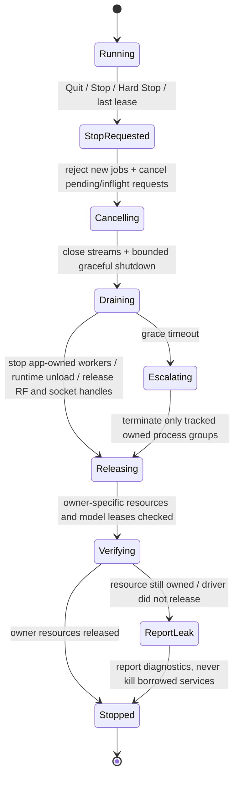

# Resource Ownership & Hard Stop Contract — v0.9

**Status:** User-confirmed lifecycle requirement; planned integration contract, **not yet a functioning resource manager**. This specification applies to TIHULU AI Tools, both experimental chat agents, future GPU host/remote inference, TIHULU-owned inference runtimes and authorized independent application adapters. Other TIHULU app repositories are unchanged until their preservation audits and integration approvals complete.

## Core invariant

> When a TIHULU application, AI task, or an exclusively app-owned AI Tools session ends, **release everything it owns**: local/remote AI task leases, model allocations in RAM and VRAM, loaded inference contexts, owned child workers/process groups, network streams, file handles, temporary resources and SDR device handles. **Never stop or unload resources owned by an unrelated application or a shared/pre-existing service.** A shared model can remain resident only while another authorized active client or an explicitly independent server policy still legitimately owns it.

The default policy is **On-Demand / Background OFF / No keep-warm models**. A finished idle task must not leave a live AI Tools-owned model in VRAM merely because the GUI window was previously open.

## Explicit ownership model

Every runtime resource and task session must record an immutable owner and policy before allocation. Owner kinds:

- `AppSession`: a specific TIHULU app launch/session, e.g., Text Center `transcribe-...`.
- `AgentSession`: Advisor or App Control Agent chat session with a parent app session.
- `HostClientLease`: a particular authorized client of a paired GPU host; model residency belongs to the shared host's **lease set**, never to one client's right to kill the host.
- `AppOwnedChild`: an inference/ffmpeg/SDR subprocess spawned and supervised by a single owner, process handle/group, identity token and cancellation handle retained.
- `ManagerOwnedService`: an explicitly started independent TIHULU AI Tools server/daemon whose lifecycle is distinct from a UI window; each client still obtains separate workload leases.
- `BorrowedExternal`: Jan, Ollama, LM Studio, user-started readsb/tar1090, already-running provider endpoint, or other externally managed services, possibly providing models or hardware. Borrowing does **not** grant permission to terminate/reconfigure the service.
- `SharedOwned`: a TIHULU-owned runtime/model context used by multiple authorized sessions; reference-count actual active consumers and optionally in-flight request guards.

Model owner, model file path owner, **runtime process owner**, loaded GPU model, and client app are separate concepts. A model stored in Jan can be used from a separately owned TIHULU inference worker without taking ownership of Jan itself.

## Shutdown state machine

Required behavior:
1. Trigger on Quit, Close Window (when that window is the only local application lifetime), explicit **Stop AI** / **Hard Stop**, app task cancellation, device disconnect, last shared-client release, signal (`SIGINT`/`SIGTERM` where available), OS window/session close and expected error paths.
2. Transition idempotently to `StopRequested`; deny new work, propagate cancellation to all owned jobs and remote leases and await bounded graceful completion. If closing only a panel but the app still has another authorized active session, release **the panel's** tasks rather than stopping the whole app.
3. Stop owned inference workers and release local model handles; remote host receives **cancel/unload lease for this client**, not “kill host process”. The host itself unloads a shared model when its **last authorized active lease** ends and the configured residency policy does not explicitly retain it.
4. Explicitly request runtime unload/model-session disposal, close GPU/CPU contexts, free buffers and any owned decoder/transcription/OCR/translation contexts, release RF/SDR USB leases, close connections/IPC/network sockets and delete **owned temporary files** per retention policy.
5. Graceful timeout -> escalate **only to process groups/PIDs and child handles spawned/owned by this app instance**. Never kill by image name (`pkill ollama`, `killall readsb`, broad GPU process matching etc.), never stop generic system services or shared receiver daemons.
6. Check observable results: owned child gone or exited, SDR handle released, local/remote model lease no longer present, GPU allocation attributable to the owner dropped as expected. Report remaining allocations or uncertain accounting honestly; do not claim that *all system VRAM* becomes zero or every allocator instantly returns memory to the OS.
7. Handle abrupt crash/restart with supervised child ownership and host heartbeat/lease expiry; an orphaned lease is cleaned up by its **own** host after timeout. Where safe, OS-native job/process group supervision prevents lingering children. A non-owned pre-existing process remains untouched.

## Distinguish close modes

| Action | Stop/release | Preserve |
| --- | --- | --- |
| AI Advisor or App Agent chat closed | Its task/LLM session, inference context, tools, temporary buffers and host lease | Other chat, app or host clients |
| TIHULU app **Exit/Quit** | All jobs, AI models/runtimes and SDR handles **owned by that app**; process children it created | Jan/Ollama/readsb/tar1090 started elsewhere, other app sessions, shared host used by others |
| TIHULU AI Tools UI **Quit** | UI-owned jobs/models; any service started exclusively for this UI and not configured independent; open client leases | **Explicitly configured independent host service** with active authorized clients; if user chooses Quit All TIHULU Services, it must ask/notify, drain clients and stop only TIHULU-owned host |
| AI Tools model-job **Stop** | This job's model lease, streams and temporary allocation | Other consumers of same model or host |
| **Global Hard Stop** in an app | Every resource owned by that app (including AI and SDR), regardless of module | Everything outside app ownership |
| Last host-client lease ends | Host unloads model/runtime context as soon as safe under no-keep-warm default | Host process itself if independent service explicitly enabled; other models still in use |
| Externally hosted Jan/Ollama inference | Cancel only authorized request, release client-owned buffers and streams | Jan/Ollama process, cached weights, external service and other clients; external VRAM cache is not ours to force-clear |

**If the user wants absolutely no TIHULU-owned background service after closing all TIHULU apps**, provide an explicit **Quit All TIHULU-Owned Services** command with clear impact on other TIHULU clients. It must not forcibly stop non-TIHULU services or infrastructure managed by another app. Independently configured server-mode is opt-in and visibly labelled.

## Component responsibilities

| Workstream | Shutdown acceptance responsibility |
| --- | --- |
| **01 Platform / installers** | Linux POSIX signals/process groups, macOS app Quit/child supervision, Windows Job Objects / job termination semantics, Pi native service policy; no implicit daemon and clean uninstall |
| **02 Model Registry / discovery** | Track model artifact owner vs runtime owner and active lease references; discovery never loads weights; no leaked locks on exit |
| **03 Model Market / compatibility** | Catalog lookup and tests cannot keep model workers resident; session ownership recorded for each optional smoke test; no keep-warm by default |
| **04 GPU Host / remote compute** | Rust client lease IDs, cancellable requests, host-side reference counting, TTL/heartbeat, disconnect/crash recovery, unload last client's model and quota release; **do not shutdown a shared host** |
| **05 Integrations / Jan MCP / app SDK** | Per-tool cancellation/cleanup, Jan and pre-existing service borrowing, SDR owner protocol, `aipath.txt` independent app shutdown, prevent “kill by name”; mock active readsb/tar1090 unaffected |
| **06 UI / chat UX** | STOP, Quit, Hard Stop semantics, live owned-model and RAM/VRAM status, owner labels, shutdown progress, no hidden active workers and warnings for an explicitly independent host |

The coordinator-owned `tihulu-ai-core` should define pure typed resource ownership, cancellation and cleanup contracts; adapters then supply actual handles. No app source or hardware is modified by this document.

## Memory/VRAM lifecycle realities and verification

- Calling a `free` function or deleting a model file is **not** equivalent to releasing a GPU context; real backend-specific model/session teardown is required. Closing an owned process generally releases its own GPU allocations, subject to OS/driver completion.
- The host must distinguish *process resident VRAM* from *all device VRAM*: a GPU shared with Jan, a desktop compositor and other clients will continue using VRAM. Only owner-attributable usage can be asserted as released.
- RAM allocators may keep capacity while a shared process remains running even after a model has been unloaded. Tests should focus on model/context handles, per-session allocation accounting and bounded residual resident memory instead of insisting that system-wide RAM always returns to a single exact value.
- A model is **never** removed from disk by stopping or closing an application. The common model library and original external paths remain intact.
- Remote Pi → PC cancellation requests must be authenticated per-client, resistant to repeated/out-of-order requests and must not cancel another client's job.
- For shared services or service keep-alive explicitly configured by the user, visible **active ownership and keep-warm status** must be displayed. Background stays OFF by default.
- No WebUSB is needed for native hardware ownership release.

## Regression/acceptance matrix (synthetic first, hardware later)

| ID | Scenario | Expected observable result |
| --- | --- | --- |
| L-01 | Start AI Tools-owned local model task then Exit | Its worker gone, model/context unloaded and owner memory resources released; no background process remains |
| L-02 | Close Advisor while Agent remains active | Advisor model lease released; Agent and shared context for Agent continue |
| L-03 | Two authorized apps use same PC host model; first exits | Only first lease/cancellable jobs removed; second app and host stay functional |
| L-04 | Last GPU-host client exits | Shared host model unloaded and VRAM allocation attributable to that model drops; independent host daemon may stay idle if explicitly enabled |
| L-05 | App with local SDR/USB receiver Hard Stop | Owned device handle closed and device available to next owner, no dangling RF capture |
| L-06 | App had attached to pre-existing readsb/tar1090 | Stop/Exit does **not** terminate or reset external services and does not release their exclusive hardware lock forcibly |
| L-07 | App using external Jan/Ollama model exits | Our request/streams ended; external Jan/Ollama process, models and their VRAM retention unaffected |
| L-08 | Owned inference subprocess ignores cancellation | Grace timeout then only its tracked child/process group terminated; no `pkill`/process-name kill |
| L-09 | Host/transport disconnect during Pi job | App receives cancellation/unavailable signal; remote lease eventually expires and host unloads only its orphaned context |
| L-10 | Force Quit/crash/restart | Supervised children and timed-out remote leases reclaimed, no borrowed service killed |
| L-11 | App relaunch after Exit | Fresh resource session; no duplicate child or stale lease and model loads only on demand |
| L-12 | Independently enabled GPU host with active third-party TIHULU client when UI closes | UI exits; host and client survive as explicitly configured and user sees policy |
| L-13 | Explicit `Quit All TIHULU-Owned Services` | User warned; stops all **owned** clients/host jobs and resources, but not pre-existing external services |
| L-14 | Windows, macOS, Linux x64/ARM64 CI mocks | Ownership/cancellation state machine tests pass; physical GPU/NPU/SDR release still requires hardware trials |
| L-15 | Two apps use separate models in same shared runtime | Closing one unloads only its model if unreferenced; unrelated model remains |
| L-16 | User closes an app while a model download is in progress | Owned download stops/persists according to explicit resume policy; no dangling network worker, no partial model misreported as installed |

## Test gates

1. Rust unit tests for owner/lease state machine, idempotent cancellation, shared reference counting, stale lease timeout, permission boundaries and never-stop-borrowed invariants.
2. Integration tests with dummy child processes, mock Jan/Ollama/readsb services and shared GPU host jobs on supported OS CI.
3. Native hardware tests on Pop!_OS RTX 5080, Raspberry Pi 5 (CPU), Raspberry Pi 5 + AI HAT+ 2 (Hailo), compatible SDR, macOS Apple Silicon and Windows; inspect actual relevant process/VRAM/SDR release without asserting unused hardware system memory equals zero.
4. Code owners must attach logs, before/after model-lease counters and actual measurements for any hardware acceptance; mocked CI cannot claim it.

**Implementation note:** This requirement is added to agent tasks while the existing independent app audits continue. Later app-repo integration requests will need equivalent ownership-safe release tests; do **not** change external apps here.
