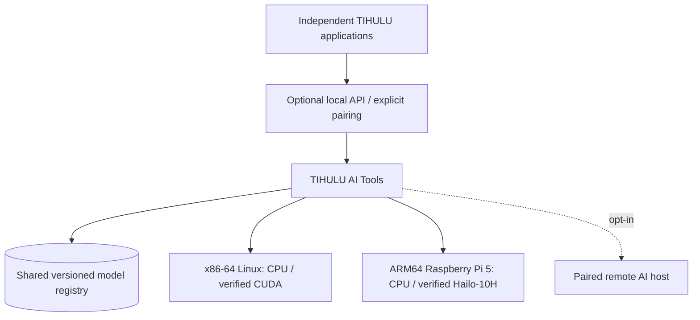
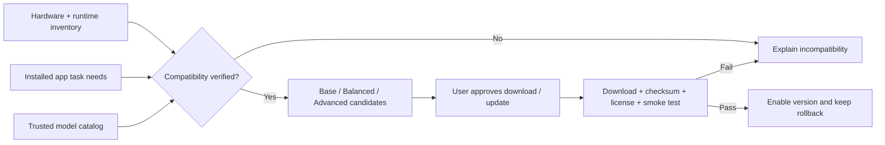
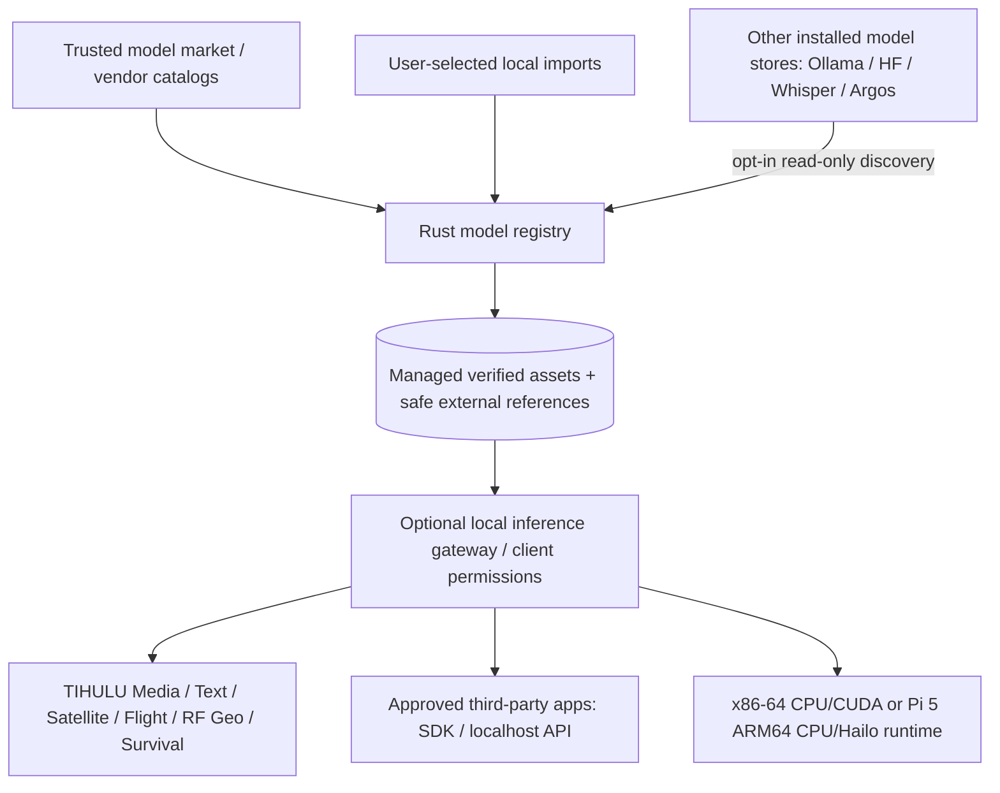
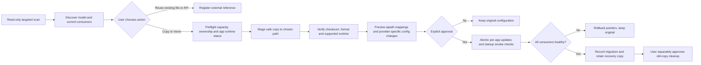
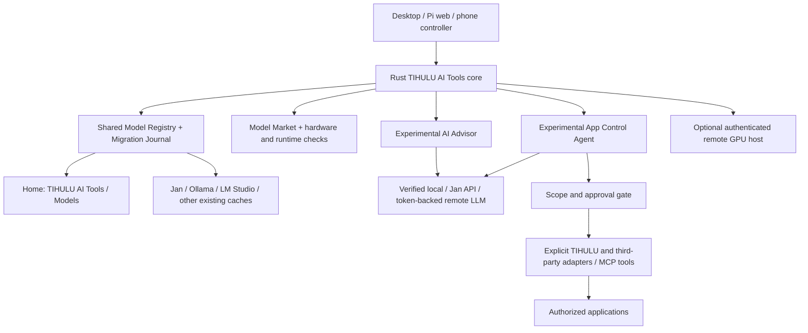

# TIHULU AI Tools — Architecture & Product Plan

> **GitHub migration note (2026-11-12):** The original v0.4 planning text is preserved in this repository. Its legacy downloadable ZIP also contained standalone PNG/SVG/DOT files; those binary assets have not been migrated. References below point to [GitHub-native, editable Mermaid diagrams](ARCHITECTURE.md) or the [interactive HTML mockup](../ui/index.html) instead. These represent design concepts, not tested software.

> **Status:** DRAFT v0.9 — independent Rust foundation underway; lifecycle ownership & clean shutdown requirements approved  
> **Date:** 2026-11-12  
> **Language:** Technical documentation in English; planned product UI in English, Turkish, and German  
> **Change policy:** Planning only. **No existing applications, branches, repositories, installers, or models are modified.**  
> **Prerequisite:** Finish the independent application repository audit/split before implementation.

## 1. Purpose and scope

TIHULU AI Tools is a **standalone, optional, cross-platform application and future independent repository** that discovers available AI hardware, inventories installed models (including user-approved models managed by other programs), recommends **verified compatible** models for TIHULU application tasks, safely downloads and updates them, exposes a user-managed Model Market, and manages local and opt-in remote inference via a Rust-first architecture.

This document separates explicit **confirmed requirements** from **proposed designs awaiting approval**. No model, runtime, library or hardware configuration is considered functional until actually tested on the relevant target.

### Decision register

| ID | Requirement / decision | Status | Notes |
|---|---|---|---|
| R-01 | Create independent **TIHULU AI Tools** application and eventual repository | **Confirmed** | Implement after existing app repository separation |
| R-02 | Manage AI models in a dedicated, configurable storage directory, not in source Git repositories | **Confirmed in principle** | Exact default paths are proposals |
| R-03 | Discover host hardware and recommend suitable models for installed TIHULU apps | **Confirmed** | Must verify runtime and model, not merely detect device |
| R-04 | Discover current versions and allow model download, install, and update | **Confirmed** | Secure procedures/approval below are design proposals |
| R-05 | Support both **x86-64** desktop systems and **ARM64/aarch64** Raspberry Pi 5 | **Confirmed** | Build and package natively per architecture |
| R-06 | Support **Raspberry Pi 5 + AI HAT+ 2 (Hailo-10H)** | **Confirmed** | Only Hailo-supported model artifacts/run paths are eligible |
| R-07 | Preserve app independence, existing features/settings, and compatibility during migration | **Confirmed, inherited project rule** | Never make AI Tools a mandatory startup dependency |
| R-08 | Keep technical development and docs in English; UI EN/TR/DE | **Confirmed, inherited project rule** | Localization applies to AI Tools too |
| R-09 | Default to on-demand execution; no unexpected background downloads or inference | **Confirmed, inherited project rule** | Background/Always-On opt-in |
| R-10 | Implement a **Rust-first** AI Tools core, manager and application architecture | **Confirmed** | Tauri 2/Axum and specific crates are design candidates, not implementation commitments |
| R-11 | Offer a **Model Market** with current model discovery, user-chosen downloads, version management and **custom model import** | **Confirmed** | Private/local catalog first; public marketplace publishing is not yet approved |
| R-12 | Detect user-approved **already-installed models** and reuse them across clients without unnecessary re-downloads or storage copies | **Confirmed** | Reuse by compatible file variant or serving API, not a guarantee of shared GPU memory |
| R-13 | Provide a dedicated **My TIHULU Apps** view and model/task assignment controls | **Confirmed** | All six application families stay optional consumers |
| R-14 | Permit **non-TIHULU external software** to use models already on the host with explicit permissions and supported adapters | **Confirmed** | API/socket integration or reference to an existing runtime, not universal direct file compatibility |
| R-15 | Manage discovered devices, host selection, libraries, downloads, versions, permissions and runtime jobs from the UI | **Confirmed** | No hidden background service or network listener by default |
| R-16 | Supply an **interactive UX concept** and include screenshots/diagrams in the evolving Markdown plan | **Confirmed** | Preview is simulated; not a functional client or installed software |
| R-17 | Replace hardware preview selector with **Auto Detect**, **Regular Computer**, **Performance / Experimental**, **Raspberry Pi 5 — 8 GB**, **Raspberry Pi 5 + AI HAT+ 2**, **Custom** | **Confirmed** | Profiles are filters; do not claim tested runtime readiness |
| R-18 | Add dedicated **GPU Server / Remote Compute** tab; host model inference for paired Pi, phone and other devices | **Confirmed** | Web/mobile clients are consumers by default, not GPU providers |
| R-19 | Support **PC-stored model → PC inference → remote client** | **Confirmed** | Remote requests use authenticated inference API; model need not be copied to client |
| R-20 | Support **device-stored model → PC GPU execution** where format/license/availability permit | **Confirmed** | Requires verified access or explicit transfer, approved cache, compatible runtime; not direct raw remote GPU exposure |
| R-21 | Support LAN / Ethernet, including **direct PC↔Pi Ethernet**, with optional secure remote VPN access | **Confirmed** | Pairing, encrypted transport, IP/DNS and firewall checks required |
| R-22 | Ship **one shared AI Tools installation** in future TIHULU app installation workflows | **Confirmed target** | Detect installed manager and reuse; consent, reversible setup, no per-app duplicate; old apps still start if manager unavailable |
| R-23 | Add **Installations & Paths** control to relocate AI Tools/models and configure each integrated app's approved read paths | **Confirmed** | Explicit approved writes, validate path ownership, atomic updates/backups |
| R-24 | Implement per-application plain-text **`aipath.txt`** compatibility bridge | **Confirmed** | Offline local paths work without GUI/daemon; design format proposed below |
| R-25 | App startup must never require launching the **AI Tools GUI** | **Confirmed** | Direct local path or already running engine, fallback to old settings; remote inference requires reachable host service |
| R-26 | When independent repos are ready, plan integration requests/PRs for **all TIHULU application AI adapters** | **Confirmed future work** | No application code changes during current audit/split |
| R-27 | Keep **Rust-first** manager/agent/UI transport on x86-64 and ARM64 | **Confirmed** | Existing inference engines may be non-Rust dependencies under adapters |
| R-28 | Include mobile/tablet-friendly browser control, including pairing from a phone | **Confirmed** | Future native Android/iOS compute-agent compatibility is a separately validated proposal |
| R-29 | Default user-visible model library **`~/TIHULU AI Tools/Models/`** (Windows user home equivalent) with configurable paths | **Confirmed** | Native OS metadata/config folders remain separate; Pi SSD relocation supported |
| R-30 | Discover local and existing third-party model libraries including **Jan**, via safe, consented scan | **Confirmed** | Jan Flatpak/native and changed data folders must be handled; avoid entire-disk crawling by default |
| R-31 | Identify installed models before downloading; map compatible models to TIHULU and external apps | **Confirmed** | Detect duplicate content and format/runtime restrictions |
| R-32 | Offer link-in-place, registered re-use, copy, move, and custom library relocation with **no application breakage** | **Confirmed** | Read-only discovery first; staged migration, live consumer detection, backups and rollback |
| R-33 | Add **Experimental In-App LLM Advisor** to explain AI Tools, answer user questions, recommend/download models via approved Market flow, and guide app integrations | **Confirmed feature goal / experimental** | No unsupported claim of autonomous repair or integration; requires an adapter and user approval |
| R-34 | Advisor can select an existing local model or connect to a user-configured token-authenticated external LLM provider | **Confirmed** | Secrets stored in OS credential vault; never `aipath.txt` or logs |
| R-35 | Add separate **Experimental App Control Agent**, which can use approved models, choose a model from the Market, plan and perform authorized tasks in supported apps | **Confirmed feature goal / experimental** | Tool/action permission scope, approval for effects, complete activity log, kill switch |
| R-36 | Permit optional Internet use for Advisor and Agent | **Confirmed** | Permissioned network tools, visible outbound requests, per-app/domain approval and offline mode |
| R-37 | Enable third-party and open-source application integrations through adapters / MCP / documented APIs / optionally repo workflows | **Confirmed target** | Not unrestricted OS access; source modifications require explicit project scope and review |
| R-38 | Keep AI Tools orchestration, model registry, path migration, agent and provider plumbing **Rust-first** | **Confirmed** | Model inference engines remain format-appropriate native runtimes |
| R-39 | Preserve existing applications and their model managers until independently tested migrations complete | **Confirmed** | Future integration work only after six-repo audit and split |
| R-40 | Extend UX with model-source scanner, safe move wizard, **AI Advisor** and **App Control Agent** tabs | **Confirmed** | Preview/mock actions only until implementation |
| P-11 | Use **HTTPS/OpenAI-compatible subset** as the default remote inference protocol, plus typed Rust JSON endpoints | **Proposed** | Better-supported and safer than raw distributed tensor RPC |
| P-12 | Support optional Tailscale/WireGuard tunnel for away-from-home peers | **Proposed** | No public model-server port by default |
| P-13 | Provide a managed, consented **model staging cache** for Pi-stored models executed on PC | **Proposed** | Content hashes, temporary encrypted transport, retention policy, user choice |
| P-14 | Add a signed per-app integration manifest and `aipath.txt` parser with strict allow-listed keys | **Proposed** | Legacy config stays unmodified until explicit migration |
| P-07 | Tauri 2 desktop shell + embedded web UI, Rust Axum local server and headless Pi mode | **Proposed** | Validate Raspberry Pi WebKitGTK/UI packaging; headless web interface is the fallback |
| P-08 | Rust Cargo workspace with SQLite metadata, content-addressed asset references and adapter interfaces | **Proposed** | Files belonging to Ollama/other runtimes remain under their owners unless explicitly imported |
| P-09 | Limited OpenAI-compatible localhost API + task-specific endpoints + local Unix socket | **Proposed** | Authenticated, per-client scoped, protocol coverage documented |
| P-10 | Optional signed community catalogs and user-published model packages | **Future proposal** | Not required for local custom import; moderation/security/licensing design first |
| P-01 | Use a shared model registry with per-model manifests, version pinning, hashes, rollback | **Proposed** | Approval pending |
| P-02 | Use Base / Balanced / Advanced hardware-adaptive profiles | **Proposed** | Profiles choose tested, not merely theoretically fitting, models |
| P-03 | Add native desktop UI, local-only API, opt-in remote GPU-host pairing | **Proposed** | API/security design requires review |
| P-04 | Use an external SSD or custom data location when desired | **Proposed implementation** | Preserve/import existing model paths without moving automatically |
| P-05 | Offer a benchmark/quality comparison workflow for models | **Proposed** | Different tasks require different quality metrics |
| P-06 | Target Linux x86-64 + Pi ARM64 first; add macOS ARM64 / Windows x64 after validation | **Proposed rollout** | Cross-platform ambitions already exist in wider TIHULU project |

## 2. Target hardware and operating systems

| Target | ISA / OS | Compute engines to detect | Compatibility rule |
|---|---|---|---|
| User desktop (reference) | **x86_64**, Pop!_OS 24.04 / Linux | CPU; NVIDIA RTX 5080 (16 GB VRAM) **when the installed runtime is verified** | CUDA device existence does not prove compatible driver/CUDA/CTranslate2/model |
| Raspberry Pi 5 | **aarch64**, Raspberry Pi OS **64-bit** | ARM CPU; optionally Hailo-10H on AI HAT+ 2 | Check OS, firmware, driver, HailoRT, supported artifact and inference API |
| Optional remote host | x86_64 or aarch64 (capability-advertised) | CPU/GPU/NPU as supported | Explicit pairing, authentication, isolation, resource budget |
| Future | Windows x64, macOS Apple Silicon | CPU and supported vendor GPU frameworks | Dedicated installers and acceptance tests; not implied ready in v0.1 |

### Crucial distinction: architecture vs accelerator compatibility

* An `aarch64`-compatible binary or model loader may still be **incompatible with Hailo-10H**.
* **AI HAT+ 2** contains a **Hailo-10H, 40 TOPS (INT4), and 8 GB of dedicated memory**. The 8 GB is **not** Raspberry Pi system RAM and is **not** an interchangeable 8-GB CUDA GPU.
* Raspberry Pi's documentation supports compatible vision and generative AI (LLM/VLM) workloads on AI HAT+ 2, but **not arbitrary GGUF, Whisper, PyTorch or Hugging Face model files out of the box**. Models must have a supported vendor runtime/artifact and verified software stack.
* A model marked “Pi CPU compatible” must not be marked “Hailo NPU ready” without a real local inference test.
* The Raspberry Pi official AI software instructions currently specify **64-bit Raspberry Pi OS Trixie** for the documented Hailo setup. If other distros are added, compatibility must be tested and recorded rather than assumed.

**Official hardware references:**
- [Raspberry Pi — AI HATs and AI HAT+ 2](https://www.raspberrypi.com/documentation/accessories/ai-hat-plus.html)
- [Raspberry Pi — AI software and Hailo setup](https://www.raspberrypi.com/documentation/computers/ai.html)
- [Raspberry Pi — AI HAT+ 2 product page](https://www.raspberrypi.com/products/ai-hat-plus-2/)

## 3. System architecture (proposed)

**Cross-platform architecture** — [See the GitHub-rendered Mermaid architecture diagrams](ARCHITECTURE.md).

The diagram is an editable SVG; the following Mermaid block is the text-source fallback for Markdown viewers supporting Mermaid.



### Separation rules

1. Media Center, Text Center, Satellite Center, Flight Radar, RF Geolocation and Survival Kit retain their own repositories, installation paths, configuration, operational functions and release lifecycles.
2. AI Tools is **optional**. If unavailable, clients preserve their **current working** AI choices and non-AI functions; migration must not remove or silently replace existing processing paths.
3. AI Tools owns model catalog metadata, shared storage references, compatibility reports and optional inference coordination. Each installed application declares only its own task needs.
4. Default service mode is **off/on-demand**; API listens on loopback only unless separately and securely enabled for LAN access. Remote pairing is an opt-in feature.
5. TIHULU AI Tools is not the RF/SDR hardware broker; radio receiver ownership stays with the relevant independent app/service.

## 4. Proposed source-code layout

```text
tihulu-ai-tools/                  # future independent Rust-first repository
├── Cargo.toml                   # workspace; Rust packages and shared types
├── crates/
│   ├── ai-core/                 # service orchestration and state machine
│   ├── hardware-probe/          # x86-64 / ARM64 / CUDA / Hailo checks
│   ├── model-registry/          # asset identity, aliases, references, SQLite
│   ├── model-market/            # catalogs, user imports, ranking, licenses
│   ├── download-manager/        # staging, integrity, rollback, progress
│   ├── inference-gateway/       # local API, auth, routing, quotas
│   ├── runtime-adapters/        # llama.cpp / Whisper / Argos / Hailo / Ollama
│   └── host-agent/              # opt-in local daemon / paired host
├── apps/
│   ├── desktop/                 # proposed Tauri 2 native application
│   │   └── src-tauri/           # Rust entry point and permissions
│   └── web/                     # local browser UI, served by the Rust agent
├── integrations/               # TIHULU + external client contracts
├── packaging/                  # Linux x86-64 and Raspberry Pi ARM64 releases
├── docs/                       # decisions, diagrams and mockups
└── tests/                      # unit, protocol, hardware acceptance tests
```

**Model files do not belong under this Git checkout.** Rust provides lifecycle management and interfaces to verified runtime backends; it does **not** imply reimplementing CUDA, Whisper, HailoRT, llama.cpp or Argos entirely in Rust.

## 5. Model storage strategy (historical proposal; **superseded by confirmed v0.4 home-folder default in §26**)

| System | Proposed default for model data (user-overridable) |
|---|---|
| Linux x86-64 and Raspberry Pi ARM64 | `${XDG_DATA_HOME:-$HOME/.local/share}/tihulu/ai-tools/models/` |
| Windows x64 (future) | `%LOCALAPPDATA%\\TIHULU\\AI-Tools\\Models\\` |
| macOS (future) | `~/Library/Application Support/TIHULU/AI-Tools/Models/` |
| Any supported host | User-selected mounted SSD or path, provided it is writable and has sufficient storage |

Potential layout:

```text
models/
├── manifests/                 # model IDs, license, source, SHA-256, dependency info
├── speech/                    # whisper.cpp / faster-whisper by variant
├── translation/               # approved language-pair assets
├── llm/                       # approved CPU/GPU/Hailo variants
├── vision/                    # OCR, classifiers, VLM assets
├── hailo-10h/                 # vendor-supported compiled artifacts
├── staging/                   # resumable/uncommitted downloads
└── versions/                  # version pinning / rollback metadata
```

**Migration constraint:** First discover installed model paths and record ownership. Do not silently move, delete or rewrite legacy caches. Offer copy/import or keep-in-place references with explicit user approval. Delete shared assets only when no client references them and the user confirms.

### Existing Text Center integration evidence (not a migration plan)

The present repository uses user-supplied local paths for Whisper model artifacts and does **not** automatically download them:

- `TIHULU_WHISPER_MODEL` (whisper.cpp CPU file)
- `TIHULU_FASTER_WHISPER_MODEL` (faster-whisper CUDA directory)
- `TIHULU_OPENVINO_WHISPER_MODEL` (OpenVINO model directory)
- `TIHULU_HAILO_ENCODER_HEF`, `TIHULU_HAILO_DECODER_HEF`, `TIHULU_HAILO_WHISPER_NPY_DIR` (Hailo-specific assets)
- Translation language pairs are provided by installed Argos Translate packages.

Code references: [compute.py](https://github.com/Tihulu/TIHULU-TEXT-CENTER/blob/main/textcenter/compute.py), [speech.py](https://github.com/Tihulu/TIHULU-TEXT-CENTER/blob/main/textcenter/speech.py), [live translation guide](https://github.com/Tihulu/TIHULU-TEXT-CENTER/blob/main/docs/LIVE_MEDIA_TRANSLATION.md).

## 6. Hardware-aware recommendations and safe model lifecycle

**Model selection flow** — [See the GitHub-rendered Mermaid architecture diagrams](ARCHITECTURE.md).



### What the detector should measure

- CPU architecture and instruction-set features (`x86_64`, `aarch64`), OS release, kernel, package architecture.
- System RAM, free memory, disk space, installed model sizes and configurable storage location.
- GPU device + driver/runtime readiness (NVIDIA CUDA/CTranslate2 as applicable), **usable** VRAM and acceleration test.
- Hailo-10H presence and HailoRT/device stack, compatible model artifacts and a successful inference smoke test.
- Application capabilities and required languages (EN/TR/DE), privacy/offline requirements, expected workload concurrency and latency.

### Ranking and eligibility policy

1. **Hard reject** unsupported architecture, OS, model format, accelerator or runtime combination.
2. **Hard reject** missing legal/accepted model license or unsupported security policy; disclose license/gating requirements.
3. Estimate download footprint, remaining disk, system RAM, runtime working set, expected VRAM/NPU budget and expected throughput.
4. Label each eligible candidate **Base**, **Balanced** or **Advanced** for the local measured host and task.
5. Distinguish **Verified locally** vs **Vendor-supported / not yet locally tested** vs **Experimental**; never show mere hardware detection as a verified working model.
6. Explain recommendation rationale. Do not guarantee transcription accuracy, language coverage or realtime throughput without benchmark evidence.

### Install and update rules

- Model index refresh can be manual or opt-in scheduled; **install/update always requires approval** by default.
- Show exact source, pinned immutable revision, model format, size, version, supported languages, license and compatibility.
- Download with resumable transfers, checksum verification where hashes are available, temporary staging and atomic activation.
- Do not execute untrusted model repository scripts or turn on `trust_remote_code` by default.
- Run lightweight model load/smoke inference on the selected CPU/GPU/NPU target before advertising “Ready”.
- Preserve working version and roll back automatically if validation fails; never interrupt the active task to force an update.
- Offline-first: installed and cached verified assets still work without network; catalogs may display last-sync date.

**Relevant model-distribution reference:** [Hugging Face Hub — snapshot download options](https://huggingface.co/docs/huggingface_hub/en/package_reference/file_download). Official Hailo artifacts must be drawn from supported vendor releases for the exact NPU generation.

## 7. Application task map — candidates, not claims of implemented AI support

| Independent application | Candidate tasks | Dependency boundary |
|---|---|---|
| Media Center | Speech-to-text, subtitles, translation, OCR, speaker labeling | Preserve teletext/subtitle fallback and current ASR behavior |
| Text Center | Radio/TV ASR, EN/TR/DE translation, text extraction and classification | Keep current configured model paths and optional local inference |
| Satellite Center | Optional satellite image enhancement/classification | Never confuse decoded RF images with Internet-sourced imagery |
| Flight Radar | Optional aircraft data summarization / anomaly assistance | Core ADS-B reception and tracking must never depend on AI |
| RF Geolocation | Optional radio-signal classification / feature extraction | Geolocation must not claim accuracy based on untested AI |
| Survival Kit | Offline assistant, search/RAG, OCR, translation | All optional; local-first and power-aware on Pi |

## 8. Resource scheduler and optional remote AI host (proposed)

- Scheduler tracks model loads, requested memory, streaming latency, job priority and active processing sessions.
- Prefer reuse of a loaded inference session **only if compatible**; the same model *file* may not be usable across ARM CPU, Hailo and CUDA runtimes without separate format variants.
- Enforce memory/thermal/power constraints, particularly on Raspberry Pi 5.
- Allow a paired higher-power x86-64 GPU host to execute opted-in jobs from a Pi over the LAN while retaining local CPU/Hailo fallback when a model permits it.
- Require explicit host pairing, authentication, encrypted transport where remote networking is enabled, user-visible destination, task permission and a hard disconnect control.
- No automatic cloud transmission, background microphone capture, automatic remote model installation or surprise network exposure.

## 9. Compatibility and acceptance matrix (to be executed later)

| Test scenario | Minimum acceptance condition | Current status |
|---|---|---|
| Linux x86-64 CPU | Detect CPU; install one approved CPU model; execute controlled inference; stop cleanly | Not tested for AI Tools |
| Linux x86-64 NVIDIA GPU | Distinguish GPU detection from compatible CUDA runtime; run selected model and report memory | Not tested for AI Tools |
| Raspberry Pi 5 ARM64 CPU | Native `aarch64` package + verified small-model execution on 64-bit OS | Not tested |
| Pi 5 + AI HAT+ 2 | Hailo driver/RT, exact artifact compatibility, one verified Hailo-10H inference | Not tested |
| Pi 5 without HAT | Function correctly in ARM CPU mode; no false NPU “Ready” | Not tested |
| AI Tools not running | Every independent app retains its existing capabilities; optional AI Tools integration degrades gracefully | Not tested |
| Network offline | Previously installed models load; no mandatory network call or background download | Not tested |
| Update failure | Active previous version remains usable; rollback is reproducible | Not tested |
| Remote host disconnected | Errors are clear; local fallback only if compatible; no hidden forwarding | Not tested |
| UI languages | All AI Tools user-facing strings in EN/TR/DE | Not tested |

## 10. Delivery phases (no implementation started)

**Phase 0 — Prerequisite:** finish six workstream audits and the planned app repository split; preserve source history, features, installers and current user settings.  
**Phase 1 — Inventory:** measure installed models, paths, OS/ISA, current runtime packages and actual app task requirements.  
**Phase 2 — Foundation:** independent repository, package layout, model registry, hardware probe and native UI shell.  
**Phase 3 — Local execution:** validated x86-64 CPU/CUDA and Raspberry Pi ARM64 CPU; ARM/Hailo-10H requires a separate certified adapter and supported artifacts.  
**Phase 4 — Catalog:** recommendation ranking, secure download, atomic updates, rollback, data-location settings.  
**Phase 5 — Integrations:** opt-in per-app API, integration tests, EN/TR/DE localization, benchmarks.  
**Phase 6 — Network and expansion:** paired GPU hosts, optional extra platforms, advanced model comparison.

## 11. Open questions / approval queue

The following are **not** implicitly approved by creating this draft:

- [ ] Confirm whether the shared AI host should be **embedded in AI Tools** or shipped as a separate optional daemon/service.
- [ ] Confirm the exact storage defaults and how existing external model caches should be referenced.
- [ ] Choose whether catalog checks are manual only or optionally periodic (no auto-install by default).
- [ ] Confirm the task scheduling priority policy when two applications request the same GPU/NPU.
- [ ] Agree on the first two reference workloads to benchmark on the RTX 5080 and Pi 5 + Hailo-10H.
- [ ] Confirm whether the first releases include Windows/macOS or only Linux x86-64 and Raspberry Pi OS ARM64.
- [ ] Finalize the shared API schema, permissions, authentication and compatibility contract.
- [x] Define first UX screen map and produce interactive HTML concept (English-first mock); full EN/TR/DE localization remains unimplemented.
- [ ] Confirm final production UI technology and Rust daemon lifecycle on desktop and headless Pi.
- [ ] Confirm minimum externally compatible API subset and per-client grant model.
- [ ] Confirm whether user-created model entries stay local-only in v1 or can publish to a shared curated marketplace later.
- [ ] Define full EN/TR/DE translation coverage and accessibility review for production screens.

## 12. Next documentation protocol

When a design item is agreed, move it into the **confirmed** decision register with a stable ID and date; update the relevant component diagram and acceptance criteria. Record rejected alternatives without erasing their rationale. **No coding, migrations or GitHub commits are authorized by this document alone.**

## 13. Model Market and private custom model library — **confirmed user requirements**

**Model Market interactive mockup screenshot (archived preview image)** — [Open the interactive UI mockup](../ui/index.html).

**Interactive concept:** [Open the single-file HTML preview](../ui/index.html). The example uses synthetic inventory/model status: it does not scan hardware, download models, expose an API or modify a computer.

### Market entry channels

1. **Curated public catalogs** — search current compatible models from trustworthy registries (e.g., Hugging Face Hub), official Hailo model catalogs and runtime-specific model indexes. License/terms, source, immutable revision, checksum, intended runtime/format and warnings must be visible before install.
2. **Import local model** — register an existing GGUF/GGML/HEF or supported model directory through a user-selected path. First use a **read-only reference**; a copy into managed storage is optional, explicit and deduplicated when technically possible.
3. **Import a trusted model URL / repository ID** — validate source, downloadable artifact, license, revision, format and target compatibility before download; no arbitrary script execution.
4. **My private catalog** — personal model tags, user collections and custom manifests, usable without an Internet connection. **Publishing to a public user marketplace is still an optional future design question**, not part of confirmed v1.
5. **Installed elsewhere indicator** — if the same content/version is already available through a supported local runtime or user-authorized directory, offer **Use existing** instead of **Download again**.

Display distinct statuses: `Available remotely`, `Installed — managed here`, `Detected — externally owned`, `Available on paired host`, `Update available`, `Architecture candidate`, `Runtime verified`, `Inference verified`, `Unsupported`. **Installed does not imply executable on the currently selected host**.

Example card metadata: model name, source, publisher, pinned revision, task, license, languages, format, quantization, download size, unpacked size, memory limits, inference backend, recommended use cases, verified targets and which apps can consume it. Base/Balanced/Advanced recommendations must derive from local hardware and accepted workload tests, not marketing labels alone.

### Source and compatibility guardrails

- Hugging Face search and downloads require a known model/revision and explicit allowlisted artifact patterns where practical; some repositories are gated or disallow certain use cases. No `trust_remote_code` default.
- A generic **GGUF** file can be suitable for **llama.cpp CPU/CUDA** but must never receive **Hailo-ready** status solely because its filename says ARM or its parameter size seems suitable.
- Hailo-10H models should be discovered through the **Hailo-compatible vendor/runtime route**. A Hailo Ollama endpoint (where installed and verified) is **not** assumed binary-compatible with the ordinary Ollama artifact store.
- Users may add models not in the curated market, but imported binaries, external scripts and model weights are handled as **untrusted content** with provenance, format validation and execution restrictions.

## 14. Model reuse and discovery outside TIHULU — **confirmed user requirements**

**Proposed shared storage and client connectivity** — [See the GitHub-rendered Mermaid architecture diagrams](ARCHITECTURE.md).



### Discovery order

1. Probe **known runtime APIs**, only if installed and the user allows connection. Example: Ollama can expose a list of installed models; AI Tools can **use the running runtime** without copying its files.
2. Read explicit **TIHULU model path settings** already used by Text Center and other apps. Existing paths stay valid.
3. Offer scanning of **user-selected directories** and typical model caches (e.g., Hugging Face) with informed consent. Never blindly crawl private home directories or network shares.
4. Index source owner, version/revision, format, file size, compatible execution engines and **stable content digest** where permitted. Digesting large files should be interruptible and bounded to avoid heavy unexpected disk load.
5. For an exact compatible asset already present: reference it by immutable identity or approved path; do not copy it. For a **different runtime variant**, show why an additional converted or compiled artifact is required.
6. Maintain usage references, pinned versions and connected client grants. A user-requested removal of a **managed** model warns about every active consumer; an **externally owned** asset is never removed by AI Tools.

**Two kinds of sharing:**

- **Storage sharing:** several apps reuse one model artifact on disk (or a read-only link into another model store). This saves downloads and SSD capacity.
- **Inference sharing:** several apps call one *compatible* running service through a shared gateway and queue, potentially saving repeated model loads. GPU/CPU/NPU memory savings are workload- and runtime-dependent; no blanket guarantee.

**One machine vs two machines:** an x86-64 model already stored on a workstation does not automatically become a local file on a Raspberry Pi. The Pi can invoke a **paired remote inference host** without downloading weights locally, if the user explicitly enables and authorizes it; disconnected Pi remains independently usable for compatible installed local tasks.

### External software access contract (proposed)

External clients must **opt in** and receive scoped permission to: list safe model metadata, request specific task types, consume quotas, or access selected file paths when explicitly allowed. Default permissions: no access. Prefer loopback API or local OS socket; cross-device services require authenticated encrypted pairing and on-screen host identity. Compatible standardized APIs can be offered for supported subsets (e.g., chat, embeddings, transcription); task-specific endpoints cover translation and runtime information. Do not promise universal compatibility with every client or let an untrusted caller supply arbitrary filesystem paths or executable commands.

Proposed compatibility discovery endpoint response (schematic, **not implemented**):

```json
{
  "model_id": "local:whisper-small-ggml@verified-hash",
  "storage": "external_reference",
  "source_owner": "existing-whisper-install",
  "artifact_format": "ggml",
  "task": "speech-to-text",
  "target_arch": ["x86_64", "aarch64"],
  "runtime": "whisper.cpp",
  "readiness": "needs_local_inference_test",
  "available_clients": ["media-center", "text-center"],
  "exposure": "permission_required"
}
```

## 15. Rust-first implementation proposal — approved language, proposed framework selection

**Confirmed architectural language: Rust.** The proposed product is not a Python Electron application. Rust should orchestrate the registry, downloader, hardware probes, process life cycle, permissions, API, job scheduler, configuration and security-sensitive model paths. Runtime-specific native/Python/vendor dependencies may remain **isolated adapters** wherever they are necessary for real inference; Rust alone does not make Hailo/CUDA compatible.

| Layer | Candidate technology | Why / implementation caveat |
|---|---|---|
| Desktop shell | **Tauri 2** + Rust | Native-feeling x86-64 Linux GUI with web UI; validate WebKitGTK/ARM64 packaging and Pi desktop performance |
| Pi without desktop / remote panel | **Headless Rust agent + responsive web UI** | ARM64 service can be started on demand; browser reaches local panel only after explicit start; no mandatory WebUSB |
| Model registry | **Rust + SQLite** | Content IDs, version pins, ownership, client permissions, path references, migrations |
| Local API / web assets | **Axum + Tokio** (proposed) | Rust async HTTP, per-client tokens, loopback binding, jobs/status; Unix socket where appropriate |
| Downloads | Rust HTTP/streaming library + hash verifier | Resumable staging, limits, consent, pinned revisions and rollback |
| CPU language models | llama.cpp / other verified engines (adapter) | Engine-provided formats, architecture-specific builds, CPU memory validation |
| CUDA x86-64 | Verified native backend process/FFI | Check NVIDIA driver, CUDA and dependent runtime versions before recommending |
| Pi Hailo-10H | Vendor HailoRT / Hailo Ollama / supported model zoo adapter | Hailo-specific artifacts and firmware; only tested AI HAT+ 2 workflows |
| Existing Ollama models | Ollama API bridge | Reuse service-side installed models rather than reverse-engineering/rewriting its blob store |

**Raspberry Pi note:** official Raspberry Pi instructions for AI HAT+ 2 use Raspberry Pi OS 64-bit (Trixie), `hailo-h10-all`, device verification and a Hailo Ollama server for supported local LLM requests. This is a **separate runtime integration** from ordinary CPU GGUF usage. Document exact installed driver/HailoRT stack and keep NPU enablement opt-in. If a native Tauri frontend is unsuitable in a Pi image, the same responsive UI is served by the native ARM64 Rust agent.

**Native I/O:** desktop app uses OS device/runtime APIs, sockets and local processes rather than assuming WebUSB. The AI manager **does not take control of SDR/DVB receivers**, which retain their existing independent owners.

## 16. UX screen map and interaction model — **v0.2 concept; expanded by v0.3 §23 and v0.4 §32**

**Overview design concept (archived preview image)** — [Open the interactive UI mockup](../ui/index.html).

**GPU Server and device preview v0.3 (archived preview image)** — [Open the interactive UI mockup](../ui/index.html).

| Tab | Initial design |
|---|---|
| **Overview** | Host status, models and storage, current recommendations, alerts and quick actions |
| **Model Market** | Search/filter by task, runtime, device; vetted versions, download/import/update and compatibility explanation |
| **My Models** | Managed, linked and externally owned assets; version pinning, delete/retention, reuse, storage/SSD management |
| **TIHULU Apps** | Each of six applications, per-app `aipath.txt` preview/configuration, model/backend selection, permissions and fallback |
| **External Apps** | Local API/SDK connection, client grants, access logs, token revocation, existing Ollama/runtime bridge |
| **Devices & Hosts** | Hardware profiles: Auto Detect, Regular Computer, Performance / Experimental, Pi 5 8 GB, Pi 5 AI HAT+ 2, Custom; pair/unpair hosts |
| **GPU Server / Remote Compute** | PC-hosted model serving and Pi-stored-model execution on PC; device pairing; transport choice and mode simulation |
| **Jobs & Performance** | Active model sessions, queues, CPU/RAM/GPU/NPU usage, benchmarks, stop/hard-stop AI work |
| **Settings** | Model directories and relocations, installation discovery, `aipath.txt` target locations, privacy, updates, EN/TR/DE UI language |

### Required UX statuses and actions

- Show **Available here / Existing elsewhere / On paired host / Requires download / Unsupported** accurately, using a runtime test for **Ready**.
- Clicking **Use existing** must allow selecting an existing compatible local artifact or runtime endpoint **without downloading a second copy**.
- **Link existing model**, **Download selected revision**, **Verify**, **Update**, **Rollback**, **Release model**, **Stop session**, **Revoke client**, **Select device** must each clearly communicate whether an operation affects files, another application's runtime or network access.
- UI must support desktop/tablet/mobile breakpoints, keyboard navigation and EN/TR/DE translation of **all** production controls. The current preview includes initial language selection/selected headings only and is **not** an EN/TR/DE production implementation.
- The prototype's example installed statuses, model catalog, performance bars and buttons are explicitly simulated. **Nothing in this bundle operates the hardware, starts inference or changes GitHub repositories.**

### Preview files

- [Interactive HTML mock](../ui/index.html) — nine sections, model/device filters, simulated import, simulated market add, initial UI language selector.
- [Market screenshot (Mermaid documentation)](ARCHITECTURE.md) and [Overview screenshot (Mermaid documentation)](ARCHITECTURE.md) — static documentation images.
- [Shared model architecture diagram (Mermaid documentation)](ARCHITECTURE.md) + [editable Graphviz source (Mermaid documentation)](ARCHITECTURE.md).
- Earlier [system architecture (Mermaid documentation)](ARCHITECTURE.md) and [selection workflow (Mermaid documentation)](ARCHITECTURE.md) retained from v0.1.

## 17. Extended acceptance tests and change ledger

| Acceptance case | Expected outcome | Status |
|---|---|---|
| Model already in Ollama or installed Whisper/Argos location | User-approved discovery shows **Detected — externally owned**, no duplicate download | Planning only |
| Two TIHULU apps request the same compatible model | Same stored artifact is reused; existing working fallback paths retained | Planning only |
| A third-party app connects without approval | No model list, inference, file-path disclosure or control rights granted | Planning only |
| A third-party app connects after narrow permission grant | Only authorized task/model/rate quota is available; revoke takes effect | Planning only |
| Import unsupported GGUF for Hailo-10H | Saved as private candidate if safe, **never** shown as Hailo-ready | Planning only |
| Pi 5 ARM64, no AI HAT+ 2 | Web control panel and verified CPU models remain usable | Planning only |
| Pi 5 + AI HAT+ 2 | Device, supported Hailo runtime and exact artifact are verified independently | Planning only |
| Model shared externally, then deletion requested | Show impact, block unapproved deletion, do not delete external owner's files | Planning only |
| No network or no daemon | Existing independent TIHULU apps still run using their own supported fallback | Planning only |
| Fake UI preview | All navigation/filter/import-demo works; **no actual file, model, network or service mutation** | Preview validated |

### Change ledger

| Version / date | Changes | Approval state |
|---|---|---|
| **v0.1 / 2026-11-12** | Initial independent AI Tools scope, x86-64/Pi/Hailo support, catalog, storage, compute and diagrams | Prior approved goals + explicitly marked proposals |
| **v0.2 / 2026-11-12** | Rust-first design, Model Market, custom imports, external model discovery/reuse, third-party APIs, UI screen map, interactive prototype, new screenshots and architecture diagram | User confirmed goals; frameworks and precise API are still proposals |

### Source references (accessed 2026-11-12)

- [Tauri v2 platform and Rust architecture](https://v2.tauri.app/) and [Linux ARM cross-compilation documentation](https://v2.tauri.app/distribute/debian/)
- [Raspberry Pi AI HAT+ 2 / Hailo-10H specifications](https://www.raspberrypi.com/documentation/accessories/ai-hat-plus.html)
- [Raspberry Pi 5 AI setup and Hailo Ollama overview](https://www.raspberrypi.com/documentation/computers/ai.html)
- [Hugging Face model search API](https://huggingface.co/docs/huggingface_hub/main/guides/search)
- [Ollama API: list local models](https://docs.ollama.com/api/tags)

---

*This is a planning snapshot and an interactive UI **simulation**, not evidence that a runtime, accelerator, installer, network pairing, model API or model catalog is implemented.*


## 18. v0.3 approved feature extension — six target hardware profiles

The **hardware-profile selector is a preview/planning filter, not a replacement for live device discovery**. All statuses must distinguish detected hardware, supported runtime, model artifact readiness, and test result. The UI labels must appear in EN/TR/DE with these canonical English names:

| UI label | Preview target | Notes |
|---|---|---|
| **Auto Detect** | Locally inspected OS/ISA, RAM, accelerator, drivers, runtime | Default; user may override; demo uses mock data only |
| **Regular Computer** | Conservative CPU-oriented desktop/laptop | Works on supported x86-64 and ARM64 computer variants with compatible native builds |
| **Performance / Experimental** | More capable x86-64/ARM64 machine with verified GPU/experimental runtimes | User reference: x86-64 Pop!_OS workstation with RTX 5080; *do not equate profile with actual CUDA readiness* |
| **Raspberry Pi 5 — 8 GB** | 64-bit Raspberry Pi OS, aarch64, 8 GB system RAM, CPU | Distinguish host RAM from HAT RAM |
| **Raspberry Pi 5 + AI HAT+ 2** | ARM64 CPU + Hailo-10H NPU and its separate 8 GB memory | Hailo model format/runtime test required, no generic GGUF-on-NPU promise |
| **Custom** | User-entered OS/ISA/RAM/GPU/NPU/storage | Must show *unverified manual profile* until scanned |

A custom profile shall not be allowed to override a failed physical/runtime verification into a **Ready** status. Recommendations should include storage/memory budget, exact artifact format, license, runtime/driver pin, architecture, tested throughput and known failures.

## 19. GPU Server / Remote Compute — **user-confirmed product modes**

**Distributed compute & model ownership** — [See the GitHub-rendered Mermaid architecture diagrams](ARCHITECTURE.md).

The **control plane** (Rust UI, pairing, settings, registry) is distinct from the **data plane** (models, requests, outputs, processing engines). The browser on the phone is a *remote control and client*; it is not inherently able to serve the device's GPU. A phone *compute host* is a future native-agent target only after Android/iOS OS background/runtime limits, driver support, memory and power have been tested.

### Mode A — PC-stored model hosted on the PC

1. The Rust host detects/links a compatible model already on the PC (Whisper, Ollama, llama.cpp, Argos, etc.). A PC-managed engine must actually support the model and desired task.
2. The owner explicitly enables a host session and chooses allowed models, clients, token scopes, rate limits and resource/VRAM budget.
3. A paired Raspberry Pi 5, Pi AI HAT+ 2 or phone accesses its own browser-based local interface and selects the PC AI host. Requests travel over authenticated encrypted HTTP; **model weights remain on PC**.
4. The PC uses its verified CPU/GPU adapter. The remote device receives outputs; offline fallback uses local models when its PC host becomes unavailable.

### Mode B — Pi/device-stored model executed using PC compute

1. A model is present on Raspberry Pi/external drive, or in a verified content-addressed file store. It does **not** automatically become executable on the PC by pointing to a remote path.
2. Before execution, validate allowed model format (e.g. a compatible GGUF or other PC-capable export), license, integrity digest, architecture-independent weights, actual PC inference runtime and transfer/storage consent.
3. Prefer model transport by a **consent-based staged copy** into PC-managed cache keyed by digest (or a well-supported authenticated network share only when benchmarked and suitable). Track ownership and retention; deduplicate by hash; no silent deletion of Pi files. Merely referencing a Pi-only Hailo HEF does not enable NVIDIA execution; a different compatible artifact may be needed.
4. Execute inference **on the PC** and return results to Pi; remove temporary copies according to retention choice. Provide progress and bytes transferred for large assets.

**Important semantics:** "Pi owns the model" refers to the authoritative registered asset; execution on another host may require transferring weights. GPU is not magically mounted over Ethernet. Avoid promise of zero-copy or remote CUDA device on Android/Pi. Network disconnection, hardware mismatch, changed model hash, consent withdrawal, and disk exhaustion must lead to safe states and visible errors.

### Optional direction C — Pi/AI HAT+ 2 itself acts as host

With validated Hailo-10H artifacts and current vendor runtime (or ARM CPU models), the Pi can independently serve compatible local inference to PC/phone/apps. The PC and Pi advertise different task capabilities, so a scheduler must distinguish Hailo-specific models from general CUDA/GGUF models. The same Rust agent may act as *consumer, provider, or both* subject to resource caps.

## 20. Network transports, real-world protocol research & security decisions

| Method | What it actually enables | Proposed status / limits |
|---|---|---|
| **Ollama API** | Serve existing PC/Pi-installed models through supported native HTTP and OpenAI-compatible subset | **Preferred interoperability adapter**; preserve Ollama-owned model storage and version semantics |
| **llama.cpp `llama-server`** | GGUF and selected supported model inference over HTTP, chat/completions/embeddings APIs | **Preferred adapter** after actual engine/model compatibility and access control |
| **vLLM API** | High-throughput GPU inference; also supports x86 and ARM CPU variants | **Optional later adapter**; heavy for an 8-GB Pi and not a Hailo driver replacement |
| **Hailo Ollama / Hailo vendor runtimes** | AI HAT+ 2 supported GenAI/vision on Pi NPU via vendor-compatible endpoints | **Validated-by-device adapter only**; no universal Hailo model guarantee |
| **llama.cpp GGML RPC** | Low-level distributed ggml compute across remote accelerators over TCP/RDMA | **Research only, not enabled by default**. Official README calls it proof-of-concept, fragile/insecure. No direct public/LAN exposure in production; require separate security review before any use |
| **HTTPS / HTTP2 / WebSocket / SSE** | General model requests, streaming outputs, file transfer and job control | **Proposed Rust control/data protocol** with device pairing + authenticated scopes + TLS and loopback defaults |
| **gRPC over TLS** | Typed service-to-service RPC/streaming across paired Rust agents | **Optional future transport**, not needed for version one |
| **Direct PC↔Pi Ethernet cable** | Ordinary TCP/IP over wired link, useful when no router/internet exists | **Required use case**; address setup via DHCP or link-local/manual fallback, reachability checks and mDNS when available, always secure/authenticated |
| **Same LAN (Ethernet/Wi‑Fi)** | Connected machines reach authenticated serving endpoints | **Required**; manual IP + discovery option, no trust merely because LAN |
| **VPN (WireGuard/Tailscale)** | Encrypted connection when devices are not on same network | **Proposed optional**; no mandatory cloud account or public open port |

**Primary default design:** Rust Axum server/client + documented OpenAI-compatible **subset** for other apps, plus dedicated typed APIs for model identity, transfer, pairing, status, subtitles and translation. Do not claim arbitrary third-party endpoints are compatible until contract-tested. Use authenticated, encrypted network requests, per-device credentials, revocation, API isolation, rate limits, upload size caps, origin/CSRF protection for browser panel, restrictive CORS, audited filesystem access, explicit bind and firewall guidance. The default listener must be **loopback only / OFF until user enables host**. Secure LAN service may be a separate on-demand **headless agent** while desktop UI stays closed. Do not embed pairing credentials in a text file shared by apps.

**Official sources checked 2026-11-12:**
- [llama.cpp server documentation](https://github.com/ggml-org/llama.cpp/blob/master/tools/server/README.md)
- [llama.cpp RPC README — explicit insecure/POC warning](https://github.com/ggml-org/llama.cpp/blob/master/tools/rpc/README.md)
- [Ollama API & OpenAI-compatible endpoint](https://github.com/ollama/ollama/blob/main/docs/api/introduction.mdx)
- [Raspberry Pi AI HATs / Hailo-10H](https://www.raspberrypi.com/documentation/accessories/ai-hat-plus.html)
- [Raspberry Pi AI setup, Hailo-10H and Hailo Ollama](https://www.raspberrypi.com/documentation/computers/ai.html)
- [vLLM supported CPU platforms including ARM AArch64](https://docs.vllm.ai/en/latest/getting_started/installation/cpu/)
- [Tailscale direct/relay WireGuard-encrypted connections](https://tailscale.com/docs/reference/connection-types)

## 21. Installer, common Rust agent, locations, and **`aipath.txt`** — user-confirmed goals

**Future TIHULU applications and shared path resolution** — [See the GitHub-rendered Mermaid architecture diagrams](ARCHITECTURE.md).

### Shared install contract

- After **the six existing repository audits/splits are completed**, future TIHULU app installers include an AI Tools dependency/integration step. The AI Tools installation is **shared exactly once per machine** across all TIHULU apps, never bundled as six duplicated model stores or six independent services.
- Installation must be **user-visible, permission-aware, reversible** and preserve existing applications. Each installer checks compatible installed AI Tools versions and reuses the install; offline packaging and version pinning to be specified. AI Tools as a *managed optional component* must not break app installation/startup if user declines or component temporarily unavailable. No silent uninstall of current engines/models.
- Manager locations and model libraries **independently configurable**; applications themselves remain independently installable/movable. Examples: `~/.local/share/tihulu/ai-tools/`, external SSD, Pi partition, custom location. Windows/macOS paths will be OS-appropriate, not copied literally from Linux.
- Existing model sources (Ollama, Whisper, Hugging Face, Argos, external application folders) remain externally owned if linked read-only; all moves/migrations require explicit approval and recovery plan.
- AI Tools UI records **installed paths for itself and for each approved application**, per-host registry ID and per-model available paths, and can generate/update a per-app bridge file where that application has explicitly added `aipath.txt` support. It must never blindly rewrite app files or existing app package code.
- **A running AI Tools desktop window is never a prerequisite to launch a TIHULU app.** Local direct model references must resolve without a resident daemon. Only remote inference/shared live service requires the selected headless host service (which may be started on demand) and fallback when unavailable.

### `aipath.txt` — proposed version-1 line-based schema

One text file per application, in that application's **documented, user-writable configuration directory** (or a path exposed by its integration adapter). The current repo split remains unaffected. Config is *generated per host*, never a global path string assumed valid on both PC and Pi. Example for a future desktop integration:

```ini
# TIHULU AI Tools — aipath.txt v1 (example; no secrets here)
schema=1
app_id=tihulu-media-center
manager_mode=optional
registry_path=/home/USER/.local/share/tihulu/ai-tools/registry.json
model.whisper.cpu=/home/USER/TIHULU AI Tools/Models/Speech/ggml-small.bin
model.translation.en-tr=/home/USER/TIHULU AI Tools/Models/Translation/argos/en-tr
compute_preference=local-first
remote_host_id=paired-pc-01
fallback=legacy
```

The example is a **proposal**, not an existing file or valid currently installed model. A production schema should use canonical UTF-8 `key=value` lines with a version field, explicit key allow-list, duplicate key rejection, validation, atomic write/rename, permission checks, backup, rollback and path existence/checksum checks. A missing/invalid `aipath.txt` must **not block launch**: log the reason and read the application's **pre-existing configuration**. The manager may preview changes and write only after consent. No tokens or network secrets in `aipath.txt`; host ID resolves to a protected credential store. For native/sandbox apps that cannot read arbitrary paths, use an adapter/approved API or supported user data directory rather than inventing rights. A text path alone does not grant a sandboxed process access.

**Support outside TIHULU:** Third-party apps cannot all be transparently rewritten to read this file. Use OpenAI-compatible service settings, supported integrations, user-approved symlinks or documented runtime-specific model paths. Do not alter proprietary apps behind users' backs.

### Portability, relocation, and failure semantics

- Central registry tracks *logical model ID + verified content digest + host/owner + artifact format + architecture/runtime support*, not merely a filename.
- When a managed model is relocated: stage → verify hashes → update registry → atomically rewrite approved `aipath.txt` files → health-check clients → allow rollback. Retain former copy until references are reconciled and user authorizes cleanup.
- When an application directory moves: first validate app installation ownership, then update only the mapped `aipath.txt` in the new app configuration location (or supported config integration), do not edit unrelated files.
- When a host is offline: show `host unavailable` and choose local fallback where present; never falsely mark remote model as local; don't leave half-written paths or break old configs.
- Supports per-app **local first / remote first / manual host** policy, with per-task overrides. Cached models offline only when physically available and licensed for that host.

## 22. Updated Rust workspace and responsibility boundaries (proposal)

```text
tihulu-ai-tools/                             # future independent repo, NOT created yet
├── Cargo.toml                              # Rust workspace
├── crates/
│   ├── core/                              # registry, policies, orchestrator
│   ├── hardware-probe/                    # x86-64 / ARM64 / GPU / Hailo checks
│   ├── model-market/                       # catalogs, hashes, license/manifest validation
│   ├── model-store/                        # locations, external refs, staging and relocation
│   ├── infer-adapters/                     # Ollama, llama.cpp, Hailo vendor, Whisper etc.
│   ├── remote-host/                        # pairing, TLS, scopes, job streaming
│   ├── network-discovery/                  # LAN/wired/mDNS/manual host discovery
│   ├── app-integration/                    # app manifests, aipath.txt read/write + rollback
│   ├── shared-api/                         # versioned native Rust protocol
│   └── scheduler/                          # per-host quotas, fallback, stop controls
├── apps/
│   ├── desktop/                            # Tauri 2 proposal: x86-64/ARM64
│   ├── headless/                           # Rust agent + web server for Pi or headless PC
│   └── web/                                # responsive browser UI, phone-friendly
├── integrations/
│   ├── tihulu-app-manifests/               # audit/migration plans (only after repo split)
│   └── external-adapters/                  # third-party documented APIs
├── docs/
│   ├── PLAN.md
│   ├── network-threat-model.md
│   └── protocol-compatibility.md
└── tests/
```

**Rust-first** means control, discovery, registry, transport and path management should be Rust. It does *not* require rewriting high-performance inference engines, Hailo vendor runtimes or existing Whisper implementations into Rust; prefer stable adapters with explicit versions. Tauri 2 and Axum remain proposed, not yet locked.

## 23. Updated interface specification — **v0.3 interactive mock**

The updated preview must contain **nine top-level areas**: Overview, Model Market, My Models, TIHULU Apps, External Apps, Devices & Hosts, **GPU Server / Remote Compute**, Jobs & Performance, Settings. The new Hardware profile selector has the six exact requested choices. Custom profile input is simulated and clearly labeled; Auto Detect is a **preview simulation** rather than actual system probing.

GPU Server tab has: host enable/disable simulation, **Mode A / Mode B** selector, local vs remote model-location explanation, wired Ethernet / LAN / VPN choice, paired device examples (Pi / phone / PC), per-client grants and visible session status, topology illustration, warning that raw llama.cpp RPC is excluded. TIHULU Apps has a per-app **`aipath.txt` preview generator** and path selection, with explicit **no disk writes** in the prototype. Settings shows global storage relocation and install ownership concepts. Examples are labeled, with no real service, model download, pairing or config update.

**GPU Server tab preview (archived preview image)** — [Open the interactive UI mockup](../ui/index.html).

- [Updated interactive HTML mock](../ui/index.html)
- [Architecture image (Mermaid documentation)](ARCHITECTURE.md) and [Graphviz source (Mermaid documentation)](ARCHITECTURE.md)
- [`aipath.txt` integration image (Mermaid documentation)](ARCHITECTURE.md) and [Graphviz source (Mermaid documentation)](ARCHITECTURE.md)

## 24. Test and safety acceptance checklist (unimplemented)

| Future acceptance test | Required outcome |
|---|---|
| Desktop with x86-64 and NVIDIA; Pi ARM64 and Pi Hailo+2 | Install from verified binaries, correct adapters, model readiness by runtime test |
| Select all six hardware profiles | Each switches recommended candidates; Custom stays *unverified* until actual scan |
| Start PC host then close GUI | A separately approved headless service may continue; GUI closure does not require forcibly stopping explicitly enabled jobs |
| Keep AI Tools UI and agent stopped, open Media Center | Media Center opens and reads approved `aipath.txt` local path or legacy settings without manager process |
| Pi uses PC-hosted Whisper/LLM | Only request/output network transfer; model not downloaded to Pi unless explicitly requested |
| Model stored on Pi, run using PC GPU | Confirm approved transfer/cache and compatible non-Hailo artifact; reject unsupported Hailo-only files |
| Disconnect Ethernet while inference active | Visible interruption, timeout, retry limits and fallback; do not corrupt model store |
| Pair via phone browser | TLS + owner approval required; browser may send queries, not claim direct phone GPU sharing |
| Move local model directory | Verified move; per-app path update and rollback; no destructive deletion of externally owned models |
| Install a second TIHULU app | Reuse one AI Tools installation; do not download a second model or silently change working config |
| Attempt to write `aipath.txt` to unapproved directory | Reject and explain; no arbitrary file edits |
| Host network listener after initial install | Remains OFF or loopback-only until explicit opt-in, auth, and TLS configured |
| Ask to enable insecure GGML-RPC directly on LAN | Reject in default production; research-only gated and security review required |
| Run prototype HTML and click every simulated control | Only in-memory mock UI; zero local filesystem/network/process changes |

## 25. Change ledger — additional v0.3 decisions

| Version | Changes | Status |
|---|---|---|
| **v0.3 / 2026-11-12** | Six hardware profiles; GPU Server tab; PC-hosted and Pi-stored-model-to-PC modes; secure Ethernet/LAN plans; shared installer; configurable locations; `aipath.txt` standalone resolution; app integration after independent repository split; updated diagrams and interactive UI | **User-requested scope confirmed.** Exact protocols, file schema, packages, cross-platform agent deployment and security details remain **proposed** pending architecture approval/testing. |

**Planning-only guard:** no repositories were moved, no source code installed, no device paired, no model downloaded, no existing TIHULU app code or configuration changed. Existing six audit/PR workstreams take precedence before integration PRs.


## 26. v0.4 decision — home-folder default and OS-native separation

**Status: user-confirmed storage requirement; exact casing and per-OS packaging are implementation choices.**

The user-visible, writable model library is created on *first approved installation* under the signed-in user's home, not inside any Git repository or the installed Rust application bundle. The canonical proposed display name is **`TIHULU AI Tools`** (with spaces). Tilde expands to the **current actual user**, never the root or service account by assumption.

| Target | Default shared *model* path | Manager configuration / secrets |
|---|---|---|
| Linux x86-64 desktop (Pop!_OS / Ubuntu / Debian) | `$HOME/TIHULU AI Tools/Models/` | Config in `$XDG_CONFIG_HOME/tihulu-ai-tools/` (default `~/.config/tihulu-ai-tools/`), registry/cache as appropriate in XDG state/data; secrets in an OS credential store |
| Raspberry Pi 5 ARM64 | `/home/<pi-user>/TIHULU AI Tools/Models/` | User-appropriate XDG directories; optionally relocate Models to an external SSD |
| macOS Apple Silicon | `$HOME/TIHULU AI Tools/Models/` | `~/Library/Application Support/TIHULU AI Tools/`; Keychain credentials |
| Windows x64 | `%USERPROFILE%\TIHULU AI Tools\Models\` | `%LOCALAPPDATA%\TIHULU AI Tools\` and Windows Credential Manager for secrets |

Initial example directory layout (directories may be initialized lazily, no files written during this planning phase):

```text
~/TIHULU AI Tools/
├── Models/
│   ├── LLM/                # runtime-qualified GGUF, safetensors etc.
│   ├── Speech/             # Whisper and other ASR variants
│   ├── Translation/        # installed / supported language-pair assets
│   ├── Vision/             # OCR, image, multimodal assets
│   ├── Hailo/              # supported vendor artifacts only; Hailo is NOT generic GGUF
│   └── Other/
├── Imports/                # user-approved staging, quarantined/validated
└── Exports/                # explicit user export destinations
```

**Not all native engines use plain files.** For Ollama, the manager should normally discover models and talk to the documented runtime API, not mutate its internal blob/manifests layout. Jan/LM Studio may support file references or their own servers. A single **logical shared library** does not guarantee that all programs can consume the *same physical artifact*. Where one runtime requires a conversion, report additional size and request approval before creating it. Store only approved app bridge references to models; never write personal API tokens to `aipath.txt`.

## 27. v0.4 — discover third-party model installations (especially Jan)

**User-confirmed:** discover models on the same machine before any download and show `Already installed — external` where appropriate. Initial scan is limited to known provider directories and installed service APIs, with explicit user authorization. Display `Found / Running / Usable here / Needs conversion / Managed externally / Duplicate / Missing` as *separate statuses*. Do not equate file presence with a working inference engine.

| Provider/source | High-confidence candidate | Discovery rules |
|---|---|---|
| **Jan Desktop native Linux** | `$XDG_DATA_HOME/Jan/data/llamacpp/models/`, commonly `~/.local/share/Jan/data/llamacpp/models/` | Respect Jan's selected *Jan Data Folder* in settings; parse `model.yml` if present; read-only first |
| **Jan Flatpak Linux** | `~/.var/app/ai.jan.Jan/data/Jan/data/llamacpp/models/` | Flatpak overrides XDG paths; security/sandbox boundaries apply |
| **Jan macOS** | `~/Library/Application Support/Jan/data/llamacpp/models/` | Detect configured relocation before using default |
| **Jan Windows** | `%APPDATA%\Jan\data\llamacpp\models\` | Check Jan settings for customized data directory |
| **Jan Apple Silicon MLX** | Jan data folder `mlx/models/` | Do not advertise as executable on Linux CUDA or Pi/Hailo |
| **Jan API** | Local OpenAI-compatible API, when separately enabled by user | Register as *external inference provider*; don't require re-download or duplicate Jan's service |
| **LM Studio** | Usually `~/.lmstudio/models/` or configured library; local model API | Prefer documented `lms` commands/API or user-approved reference import |
| **Ollama** | `ollama list` / documented service API and configurable `OLLAMA_MODELS` | Never rewrite internal model blobs; model may be owned by service user |
| **Hugging Face** | `HF_HOME` / `HF_HUB_CACHE` and XDG/user caches | Respect actual environment variables, symlinks, snapshots, legal/licensing restrictions |
| **Other** | User-selected folder, known llama.cpp/whisper/Argos caches, TIHULU app registry | Opt-in targeted scans; avoid searching every mounted disk without explicit action |

**Source validation:** Jan's current official [Data Folder](https://docs.jan.ai/desktop/data-folder) and [Linux Installation](https://docs.jan.ai/desktop/install/linux) guides describe Jan data directories, including Flatpak and user relocation; its [API Reference](https://docs.jan.ai/desktop/api-preference) documents a local OpenAI-compatible server. Consult version-specific docs at implementation time. LM Studio [import docs](https://lmstudio.ai/docs/app/advanced/import-model) and [API docs](https://lmstudio.ai/docs/developer/rest) describe additional integration paths; Ollama [FAQ](https://github.com/ollama/ollama/blob/main/docs/faq.mdx) describes its separately owned model storage.

**Example desired UI result:** `Jan · [example model] · GGUF Q4 · Installed externally · May be usable via Jan API / direct model reference · No download needed` plus buttons `Inspect`, `Use for TIHULU app`, `Link without moving`, `Copy to library`, `Move (wizard)`. The model itself and its real compatibility must be verified on the target system; these are not claims about the user's installed Jan models.

## 28. v0.4 — relocation without breaking existing apps

Supported path actions: **Link in place (default)**, **Copy to managed library**, **Move with migration wizard**, **Change managed library root**, **Repair paths**, and **Revert**. A regular user can reassign their user-owned models; if another application or system service owns files, its documented migration API/settings must be used rather than direct undocumented edits. Links across volumes, Windows junctions, file permissions and sandbox/bookmarks vary by OS.



**Safety invariants:** no silent file deletions or external app rewrites; collect which consumers currently reference the file; warn if Jan/Ollama/LM Studio is running or actively writing. Save previous `aipath.txt` and supported provider settings; use per-model content hash/identity, transaction journal, error recovery and simulated dry-run. Cross-filesystem "move" is copy → verify → switch clients → optional cleanup, not an unsafe rename. On interrupted copies, report incomplete staging; never declare migrated. Symlinks/hardlinks may be a useful zero-copy technique only when the target app supports them and permissions/volume allow. `aipath.txt` is written **only** for TIHULU apps with a future versioned adapter. No dependency on the AI Tools GUI at application launch.

## 29. v0.4 — Experimental In-App LLM Advisor

**User-confirmed feature goal, experimental execution:** An in-app **AI Advisor** helps with AI Tools itself, hardware questions, the Model Market, and app integrations. The Advisor uses the same model registry as the rest of AI Tools; it does not force downloading a dedicated model if a compatible local model or Jan/Ollama service already exists.

Core flow:

1. User selects **Local model**, **Existing provider (e.g. Jan/Ollama/LM Studio)** or **Remote token-authenticated LLM provider**. Auto Detect lists candidates but requires an actual inference readiness test before enabling.
2. If none is ready, the Advisor requests a suitable model recommendation from the **Model Market**. Any download, disk move or installation requires explicit consent. Hardware profiles CPU, CUDA x86-64, ARM64 Pi 5 and Hailo-10H are considered separately.
3. Advisor answers questions about AI Tools, its supported features, what the user can accomplish with selected models, and how to integrate a named application. It can read **approved** app manifests and integration documentation; it asks for needed path, API endpoint, app version, permissions, model task and access scopes; it produces an **integration plan and `aipath.txt` preview**.
4. With authorized adapters and a clear approval step, it may **propose** changes (model mapping, fallback, host selection, provider credential test) to the integration controller. The manager applies validated changes; the model does **not** edit arbitrary application files directly.
5. The Advisor can use optional Internet search/documentation retrieval after the user enables network permission. It visibly distinguishes user-provided facts from source/documentation assertions, and communicates that retrieved content can be untrusted.

**Provider credential design:** local Jan API, Ollama, OpenAI-compatible remote endpoints and additional adapters can be candidates; tokens/API keys entered into protected OS credential storage (Linux Secret Service/appropriate secure fallback, Windows Credential Manager, macOS Keychain). Scoped per-provider access; never print them in the UI, markdown, logs, crash traces, `aipath.txt`, exported backups or model manifests. On Pi headless, use a locked-down secret store or owner-only protected credential file when an OS keychain is unavailable; such fallback must be disclosed, encrypted when feasible and never silently substituted. Never embed a token in a URL. The Advisor must work in fully offline mode when a local model is actually ready.

**UX:** new `AI Advisor (Experimental)` tab; chosen provider/model, compatibility, suggestions from Market, connection test, assistant conversation, `Help me connect an application`, permission preview and `Generate integration plan` (not a one-click blind modification).

## 30. v0.4 — Experimental App Control Agent (distinct from the Advisor)

**User-confirmed feature goal, experimental execution:** The `App Control Agent` can plan and (where a compatible integration exists) perform user-requested work in a chosen TIHULU or approved third-party/open-source application. **Model quality/capability and available tools are distinct**: a local chat LLM by itself does not gain access to programs, GPU APIs, filesystem, browsing or development tools. The Market must mark tools/function-calling, context requirements, language support and benchmark uncertainty separately from raw model fit; never pretend every model is good at agent tasks.

Architecture:

- Rust **planner/orchestrator** selects a verified model, consults an app capability manifest, proposes a bounded plan, and sends structured tool calls to **registered adapters** (versioned Rust adapters, MCP servers, approved CLI/API/automation extensions where available).
- **Read-only** operations (inspect app state, open approved files, query model compatibility) are separate from **write or external-effect** operations (edit files, send network messages, invoke app commands, restart/stop services, spend money, install models). Each write or irreversible action must be reviewed, or authorized via carefully scoped repeatable approval rules.
- App permissions are **per app and per action**, never unrestricted whole-disk/shell access. User chooses explicit project folders, command allowlists, network domains, budget/time/resource caps, opt-in network access, stop switch and logs.
- For **open-source applications**, an optional developer adapter may inspect selected repo source, create changes on dedicated branches, run approved tests, then show diff/PR proposal. Never automatically merge to main, rewrite unrelated repositories, change releases/installers or delete history. This respects the ongoing separate six-app audit constraint.
- The model can choose **local installed**, **Market-recommended downloaded** (after consent), **paired GPU host**, **Pi CPU/Hailo supported** or **token-backed cloud** provider. Route tasks according to verified runtime, function-calling quality, data policy and remote endpoint permissions.
- Internet retrieval uses domain allowances, limits and source attribution. Retrieved webpages, third-party tool outputs and repository files are treated as untrusted instructions; no tool output may silently widen authorization.
- Keep execution trail: user request, selected model/provider, tool and arguments (with secrets redacted), scope, user confirmations, result, cancellation state and rollback reference. Clear **STOP AGENT** control.

Suggested action-level policies:

| Agent action | Default permission |
|---|---|
| Answer / plan / explain | Allowed when selected model ready |
| Inspect explicitly selected app status or user-approved path | Ask permission; remember per-app read scope if user chooses |
| Suggest model or show Market result | Allowed; no automatic install |
| Download model / change `aipath.txt` / install connector | Explicit approval and safe preview |
| Operate a named app via validated integration API | Scope grant and confirmation for changes |
| Edit open-source app code | Explicit repo/branch selection; diff and test review |
| Execute shell, write/delete files, stop receiver/service, send data externally | Denied by default; limited separately reviewed actions only |
| Browse web / download remote knowledge | Off by default; per-session or persisted opt-in, URL/domain controls |

**UX:** separate `App Control Agent (Experimental)` tab; task field, supported applications, chosen local/provider model, required capabilities, proposed actions with user approval toggles, execution state, audit history and STOP control. A preview cannot actually control apps or connect to the Internet. Only tested app adapters may advertise an *Available* action.

## 31. v0.4 — Rust-first implementation boundaries

Extend the **proposed** Rust workspace (not yet created) with:

```text
crates/
  model-discovery/          # Jan, Ollama, LM Studio, HF and targeted filesystem adapters
  model-migration/          # transactional copy/link/move + rollback journal
  provider-registry/        # local and external model/provider identities and permissions
  credential-vault/         # per-OS secret interface; no keys in text bridge files
  advisor/                  # bounded in-app conversational AI integration planning
  agent-orchestrator/       # planning, approvals, execution ledger, stop/cancel
  tool-bridge/              # explicit app manifests, MCP/API tools, per-action guards
  optional-web-access/      # policy-controlled browsing/documentation retrieval
  permission-policy/        # file/network/app/command scopes and audit
```

All orchestrator, storage, discovery, UI integration, API, transport and permission enforcement code is **Rust-first**. Engines such as llama.cpp, Ollama, Whisper, ONNX, Hailo's native runtime or an external Jan server remain selected and sandboxed **adapters**, not unnecessary rewrites into Rust. LLM Advisor and Agent are optional and default disabled until a user chooses a tested model/provider. Browser UI is only a front end: permission enforcement must occur server-side in Rust, even when the UI is controlled from another phone or PC.



See also the v0.4 editable Graphviz image source and rendered SVG/PNG (`assets/model_library_agents.*`).

## 32. v0.4 — expanded UX requirements and preview

The GUI/web mock now has **eleven** areas: Overview, Model Market, My Models, TIHULU Apps, External Apps, Devices & Hosts, GPU Server / Remote, **AI Advisor (Experimental)**, **App Control Agent (Experimental)**, Jobs & Performance, Settings.

- **My Models**: `Scan known locations`, `Jan detected`, `Ollama/LM Studio/HF`, read-only metadata, `Already installed`, `Link`, `Copy`, `Move safely`, `Change default root`, `Undo` (all simulated in HTML preview).
- **Settings**: displays user-home default `~/TIHULU AI Tools/Models/` in addition to proper OS-native metadata config location; exposes preview of user-chosen model storage.
- **Advisor**: choose model/provider, link local Jan/Market candidates, demo integration brief, no real inference or downloaded models.
- **Agent**: choose target app, model, task, plan steps and per-action permission toggles; STOP simulated run; no actual app/network/system actions.
- EN/TR/DE **navigation** labels updated; full translation of all prose, error messages and accessible controls remains a **future implementation requirement**, not a claim that this HTML mock is fully localized.

**Combined shared library and experimental AI agents (archived preview image)** — [Open the interactive UI mockup](../ui/index.html).

- [Interactive HTML concept](../ui/index.html) (no live model/provider discovery, browser Internet call or tokens).
- [Model discovery mock screenshot (Mermaid documentation)](ARCHITECTURE.md), [AI Advisor mock screenshot (Mermaid documentation)](ARCHITECTURE.md), [Agent mock screenshot (Mermaid documentation)](ARCHITECTURE.md), [mobile Advisor screenshot (Mermaid documentation)](ARCHITECTURE.md).
- [Editable Graphviz diagram (Mermaid documentation)](ARCHITECTURE.md) and [vector diagram (Mermaid documentation)](ARCHITECTURE.md).

## 33. v0.4 — future acceptance tests (not executed)

| Test | Required result |
|---|---|
| Fresh per-user Linux / Pi ARM64 install | Creates `~/TIHULU AI Tools/Models/` on consented install; uses native configuration dirs; service/gui not forced on |
| Jan native / Flatpak / relocated data store | Read-only Jan model discovery works; registry shows external ownership and format; no Jan config changed |
| Jan server running, tested model available | An approved AI Tools client can reuse Jan API without downloading/copying model |
| Jan model moved via permitted migration | Jan can still load or migration is blocked/rolled back; no silent path corruption |
| Ollama and LM Studio models installed | Report logical availability without mutating private manifest/blob stores |
| Move library across disks with active app | Warn/refuse while active unless safe; copy/hash/preview/switch/smoke-test/rollback, then optional cleanup |
| Open any TIHULU app with GUI/agent off | Uses its `aipath.txt` mapping or unchanged legacy fallback; never depends on UI startup |
| Advisor uses existing ready LLM | Identifies local model and runs only after user activates; provider token never leaked into app config/log/export |
| Advisor suggests new LLM | Market checks format/target/resources and requests approval before download |
| Agent task without adapter | Explains unsupported actions; does not simulate real execution success |
| Agent attempts file write/service stop/external data send | Blocks unless allowed by narrowly scoped action policy; records result |
| Internet access toggled off | No outbound network calls, including fallback LLM/search/telemetry |
| Agent STOP pressed | Cancels future authorized actions and attempts controlled cancellation of active job |
| Raspberry Pi 5 + HAT+ 2 | Uses Hailo-only paths with validated runtime; does not assume arbitrary GGUF can run on Hailo |

## 34. v0.4 change ledger

| Version | Change summary | Status |
|---|---|---|
| **v0.4 / 2026-11-12** | Home-visible `TIHULU AI Tools/Models` default, OS-native config, Jan/LM Studio/Ollama/HF discovery, no-duplicate linking, safe model move wizard and paths, experimental in-app LLM Advisor, token-backed provider option, experimental app-control Agent with policy-gated tools and optional Internet, Rust-first modules, 11-section UI mock and new architecture diagram | **New scope captured from user.** Security policies, implementation details, provider-specific migration and test evidence remain proposals; no implementation or existing app changes. |

**Planning-only guard:** v0.4 contains **specifications and a simulated HTML concept**, not functional Rust binaries, AI services, inference, model imports, credential storage or controlled applications. Existing six-repo migration/audit must complete before integration requests and source changes.

---

## 35. v0.5 approved requirement — AI Tools itself consumes a paired GPU host

**Confirmed by user (2026-11-12):** TIHULU AI Tools will run on both desktop Linux x86-64 and Raspberry Pi 5 ARM64 (including optional AI HAT+ 2). The Pi installation may pair with the PC installation and use its GPU for **AI Tools' own AI features**, not merely for unrelated TIHULU applications. The same paired host can be advertised and assigned to independently installed TIHULU applications. Rust remains the required control-plane language. **Design only; none of this is currently deployed.**

### 35.1 Symmetric installation, asymmetric device roles

- Each device may install one independent TIHULU AI Tools instance, its own model registry and optional **Rust host/agent service**.
- A device can be a **client**, a **model host**, or both, depending on installed and verified runtimes. A Raspberry Pi is fully able to send inference requests to a PC even if it cannot locally run the requested model.
- **Pi → PC:** A Pi web/desktop session chooses a paired PC GPU. The Pi's AI Advisor, App Control Agent, model recommendations and compatible model-powered AI operations request inference on the PC; results appear in the Pi UI.
- **PC → Pi (optional):** A PC may select a compatible Pi CPU or Hailo model host when the runtime really supports that artifact. This is not a promise of symmetric performance or CUDA/Hailo interchangeability.
- **Phone browser:** acts as an authenticated client/controller. Native phone GPU hosting is separate, experimental work; a web page alone is not a compute host.
- An AI Tools GUI is never required to remain open for **other applications** to run. A dedicated remote compute host service *must* be reachable while it provides remote inference, whether manually started or explicitly configured as a service. On-demand and background OFF remain the default.
- A single paired host may serve multiple independent clients subject to permissions, runtime availability, memory/VRAM budgeting, queueing and per-client limits.

### 35.2 Feature-level routing of AI Tools' own AI

The PI-installed AI Tools application must offer one compute-selector per feature, backed by a Rust routing policy rather than duplicating provider logic in the UI:

| Feature | Allowed target examples | Fallback/behaviour |
| --- | --- | --- |
| **AI Advisor chat** | Local verified CPU/NPU model, existing local Jan/Ollama server, paired PC GPU inference, user-approved token-backed provider | Explicit availability/error; no unannounced remote transfer |
| **App Control Agent chat** | Same model targets, but tool-execution permission and selected application remain **local, explicit and separate** from the remote LLM | Remote LLM only proposes instructions/structured tool requests; Rust policy engine enforces permissions on the client host |
| **Model Market recommendations** | Local hardware evaluator; optional LLM explanation via paired GPU host | Catalog browsing/hardware checks must still work if paired GPU offline |
| **Model validation/benchmarks (when implemented)** | Target host's actual runtime, if user chooses; report execution location and real results | No fabricated compatibility or performance |
| **External/TIHULU app AI tasks** | App-owned local runtime or selected authorized host | App functions remain independently available when AI Tools is absent |

The UI must display a per-task origin label such as **Running on Raspberry Pi CPU**, **Running on PC RTX 5080**, **Awaiting remote host**, or **No compatible runtime**. A local agent conversation must not misrepresent a remote LLM call as local execution.

### 35.3 Shared host assignment for TIHULU applications

On the Pi AI Tools UI, the user can select an already paired PC host and assign it to **Media Center, Text Center, Satellite Center, Flight Radar, RF Geolocation, Survival Kit**, or an authorized external client. All assignments must be **per app and per AI task**, with optional local-first / remote-first / explicit remote-only preference and a safe legacy fallback. The manager should generate/preview updates to the relevant approved application mapping (including proposed `aipath.txt`) **only after explicit approval and verified adapter support**.

- No app files are rewritten just by pairing devices or opening AI Tools.
- Each app resolves non-secret `remote_host_id` through a local paired-host registry, and authenticates with locally stored credentials. Never embed host credentials in `aipath.txt`.
- The Pi app contacts the host's secure inference endpoint using the assigned model/task ID. The PC host resolves that ID against its **own** model registry; filesystem paths from Pi are not blindly interpreted on PC.
- App-local configuration persists if the AI Tools GUI is closed. If the host is unreachable, the app must use an allowed compatible fallback or clearly mark *only that AI task* unavailable without blocking the app.
- User can inspect per-client host usage, VRAM/queue pressure, access grants and revoke an individual app without unpairing all others.

### 35.4 Proposed protocol: TIHULU Remote Compute (TRC), version 1

**Proposed, not finalized:** a narrow Rust-owned control plane over authenticated HTTPS (local Ethernet/LAN or trusted VPN), with optional OpenAI-compatible inference adapters and streamed results. The choice of certificate/bootstrap method, pairing details and API schema remains for G2 architecture review. No raw unauthenticated GPU RPC exposed publicly.

Suggested **logical** resources (not deployed URLs):

```text
/.well-known/tihulu-ai-tools     # Host discovery metadata, no secret data
/v1/hosts/capabilities           # Authenticated verified runtimes and compatible tasks
/v1/hosts/models                 # Scoped model IDs available on this host
/v1/inference/{task_type}        # Task request: model_id, app_id, timeout, request ID
/v1/jobs/{request_id}            # Job state / cancellation for authorized owner
/v1/clients/permissions          # Grants, quotas and revocation under owner control
```

- A **request** identifies a task and registered model ID, not a remotely supplied executable command, arbitrary URL or remote filesystem path.
- Prefer task-specific inference protocols for ASR/translation/LLM; an OpenAI-compatible subset is useful for chat but is not a universal interface for every model.
- Host-side Rust schedules authorized requests among verified runtime adapters; heavy inference can be done by validated external runtimes, not reimplemented in Rust.
- Pairing uses owner approval, device identity, encrypted transport, revocable per-app grants, rate limits, job cancellation and audit logs. Enforce on server, not only in the web page.
- Sensitive radio audio, television captions, documents and prompts can leave the Pi when remote compute is selected; show a clear privacy warning and require permission for data transfer.
- **Model location A:** weights already on PC, the Pi sends input only. **Location B:** weights on Pi, compatible model transfer/staging must be separately requested, validated and approved before PC can run it.
- PC hosts running Windows or Linux, and Pi hosts running ARM64, should use the same **logical protocol**, even if available runtimes differ.
- Network outage, host crash, protocol mismatch and partial output must be handled predictably; no automatic cloud fallback or hidden model installation.

### 35.5 Rust component responsibilities (proposed)

| Rust component | Responsibility |
| --- | --- |
| `tihulu-ai-core` | Local model registry, hardware discovery and task/runtime compatibility |
| `tihulu-ai-router` | Resolve local vs paired host per feature/app, model IDs, failover |
| `tihulu-ai-host` | Opt-in authenticated API, scheduling, streaming and concurrency limits |
| `tihulu-ai-client` | Paired-host discovery, identity, secure request and cancellation |
| `tihulu-ai-policy` | App capability scopes, per-tool agent approvals, secret references and audit |
| UI (Tauri / responsive browser) | Conversation timelines, model/host selectors, visible task routing |

These are **planning names**, not existing crates or files.

## 36. v0.5 approved UX — conversational AI Advisor and App Control Agent

Both experimental AI features should look and behave like **chat screens** rather than one-shot form wizards. They remain separate tabs, with clear role-specific safeguards.

### 36.1 Common chat features

- Prominent message timeline with user/assistant bubbles, timestamps when real runtime exists, task progress, and explicit **Demo response / No model called** labeling in previews.
- Input composer at bottom, optional suggested prompts, conversation reset/history (privacy scoped), distinct model/provider chooser, and **Compute on: Auto / This Device / Paired PC GPU**.
- Show active model, actual inference host, connectivity and queued/running/completed/cancelled state; do not claim success before tool results.
- Responsive layout suitable for Raspberry Pi local web interface, desktop and phone browser. Full EN/TR/DE UI remains a product requirement.
- Both chats may use local model/Jan/Ollama, paired PC GPU, or approved token-backed provider, but remote provider secrets stay in OS vault and default Internet access is OFF.
- The model market may recommend and install (with approval) a suitable local or PC-hosted model. No download is automatic.

### 36.2 AI Advisor (explain and guide)

Conversation clarifies target app, AI task, installed model, runtime, preferred host, and required permissions, then drafts an integration plan and path/API mapping for user review. **No app or file modifications** from chat suggestions alone.

### 36.3 App Control Agent (plan and request authorized actions)

Conversation can inspect approved app metadata through supported tools, propose concrete operations, and request **separate approvals** for write/network/execute actions. A remote LLM **never** directly receives credentials, device-level GPU controls or unrestricted file access on the Pi/PC. The Rust client/server permission boundaries survive model/provider changes. STOP cancels permitted jobs; audit log and previews show what was proposed vs done. Code changes require branch selection, diff/test and user review.

## 37. v0.5 acceptance criteria and change ledger (planning, untested)

1. On Pi with no compatible local LLM, Advisor/Agent can select a paired PC GPU model **without needing duplicate model weights on Pi**; remote status is visible.
2. When Pi's manager assigns that host to Survival Kit's LLM task, an adapter-ready Survival Kit reads the approved non-secret mapping and calls the paired endpoint without opening AI Tools GUI.
3. Closing the AI Tools UI does **not** interrupt an explicitly enabled independent host service; when the service is deliberately stopped, remote-dependent AI requests fail clearly while local non-AI app features continue.
4. User can deny network access and remote transfer independently for each AI chat and client app.
5. Both AI tabs show a multiline chat timeline and composer, host/model/connection status, demo-labelled responses in UI preview, and task-specific safety/permission prompts.
6. Direct Ethernet and LAN transport support identical logical service contracts after explicit pairing; no assumed zero-copy GPU sharing.
7. Route `local-first`, `remote-first` and `remote-only` preferences do not bypass compatibility checks or silently choose cloud providers.
8. All UI demo actions remain local simulation; no remote GPU, app adapter, network access, file modification or model download takes place in the planning phase.

**Ledger v0.5:** Approved requirement: GPU host can accelerate **AI Tools' own** assistants and be assigned to TIHULU apps; approve chat-style Advisor and Agent UI. Still proposed: API schema, backend choices, discovery, scheduling and service packaging. All other v0.4 requirements remain in force, GitHub documentation only.


---

## 38. v0.6 approved — Universal model discovery by application name or directory

**User-confirmed feature (2026-11-12):** Users can enter an AI application's **name**, select its **installation/data directory**, select one or more **model directories**, or give a documented **local inference endpoint**. With explicit scope-based read-only consent, AI Tools should inventory local LLM and other AI models, including Jan. It should register them under **My Models** in the Model Market as **Already installed / Externally managed** without downloading, cloning, moving, or modifying the owner application.

- Identify model engine, file formats and expected tasks, model metadata and available storage path/endpoint. Prefer reading source-native metadata and supported APIs over guessing based on filenames.
- Discover common app data directories and user-selected custom paths, including system-specific Jan locations. Don't inspect chat history, documents, credentials, API keys, agent memory or unrelated files. Respect user-defined Jan Data Folder.
- Model registry differentiates **installed artifact**, **available inference API**, **compatible runtime**, **validated task** and **mapped app usage**. These are separate statuses. A model hosted solely behind an API may not have accessible files.
- Deduplicate and reference existing copies by verified content identity and model version; never collapse formats/quantizations by display name.
- If an AI application is unknown, support a user-provided folder and mark unidentified models as **Unknown / Needs verification**, rather than claiming readiness.
- Supported target hardware continues to include Linux x86-64 RTX/CUDA, Pi 5 ARM64 CPU, Pi 5 + AI HAT+ 2 vendor-supported NPU models, and optional paired GPU hosts.

## 39. v0.6 approved — Reuse, relocate and match existing models to AI tasks

For each TIHULU app and independent AI task, show **compatible, incompatible, unknown, verified** model candidates, source owner (e.g. Jan), estimated resource needs, target runtime/host and reasoned match evidence. A user can choose **Use this model** to update *that approved app's* mapping after adapter validation and a diff preview. No new model download is required when an eligible model already exists.

- **Default**: link/reference in place; the foreign application's path and ownership are unchanged.
- Optional **copy** into user-configurable `~/TIHULU AI Tools/Models` or other allowed path after checksum+free-space verification.
- Optional **move/relocate** only through a user-approved staged migration, consumer dependency inventory, owner-native move mechanism where available, checks, backups and rollback. An external application's original files must not be silently moved or deleted.
- Allow repointing TIHULU apps to a registered external path or registered inference endpoint without changing that source path.
- Persist non-secret per-task mappings using a stable model/host reference; `aipath.txt` is a proposed compatibility bridge, not the source of provider tokens or arbitrary write permission.
- Preserve GUI-free app startup and independent non-AI functions even when AI Tools or a foreign model owner is unavailable.

See the standalone [Universal Model Discovery & Matching contract](MODEL_DISCOVERY_AND_MATCHING.md) for workflow, registry fields, adapter matrix, permission boundaries, test criteria, and example match types.

## 40. v0.6 experimental — AI-assisted online compatibility research and binding

An opt-in **AI Matching Advisor** in the Model Market and AI Advisor chat may use a verified local or paired PC GPU LLM (or a user-authorized token-backed provider) to search current public model cards and relevant application/runtime documentation, identify suitability for each task, rank candidates and prepare explicit mapping steps.

- Internet access OFF by default; ask before querying online sources. Do not upload local paths, model binaries, user files or private metadata by default.
- First filter candidates using deterministic hard requirements: modality, format, runtime, hardware RAM/VRAM/NPU, actual app adapter, and necessary features (e.g. EN/TR/DE translation direction or tool calling).
- LLM recommendations must include their sources, model versions, uncertainty and **testable** compatibility reasoning. AI-generated suggestions are not verified installation evidence.
- If user chooses a recommendation, the Rust mapping engine validates authorization, prepares a config diff, asks for explicit approval, commits atomically and tests/falls back on failure. LLM content never directly edits config, executes arbitrary app instructions or downloads/moves models.
- Ability to recommend Market download if necessary; no automatic download or silent external app modification.

## 41. v0.6 confirmed — Optional Jan integration for chat-controlled TIHULU apps

Design **TIHULU for Jan** as an **optional** integration:
1. **Jan Desktop:** Use its documented MCP client feature to connect to a future Rust **TIHULU MCP Server**. This server exposes narrow, permission-scoped TIHULU application tools while allowing Jan's chat LLM to request real supported operations; the Rust policy/adapter layer decides what executes. Connect via supported STDIO or secure local/remote transports, never unauthenticated public listeners.
2. **Jan Agent (separate product):** Consider a repository-installable plugin/package with skills, command definitions and optional MCP integration for the same server. Installing and enabling are separate, explicit acts. Do not assume the Jan Agent plugin format is the same as Jan Desktop's MCP connector.
3. **Model reuse:** Recognize Jan's existing on-disk GGUF/MLX models with read-only permission, or optionally use Jan's OpenAI-compatible local inference API when the owner runs it.
4. **Permissions:** Opt-in per app, feature and action; read-only tools by default; user approval for write/execute/network actions. The Jan model itself has no general shell, model mover, radio receiver or unrestricted machine access. No automatic changes to Jan's global MCP permission settings.
5. **Optional reverse direction:** Where a TIHULU host exposes a verified compatible API, Jan may connect to that host for LLM inference (independent of MCP tools); verify actual tool-call capabilities.

The target experience is **“While chatting in Jan, ask it to use an explicitly authorized TIHULU application capability.”** A chat-to-app integration can only expose operations that the corresponding independently developed TIHULU app actually implements.

See [Jan Integration spec](JAN_INTEGRATION.md), with dated official documentation references and future security requirements.

## 42. v0.6 UI/acceptance updates — planning only

The UX preview should contain **Discover AI App**, **Choose Folder**, **Found Local Models**, **Model → App/Task Compatibility**, **Use this Model**, **AI-assisted Match (experimental)** and an **External Apps → Jan / Enable Chat Tools (OFF)** flow. Discover and match actions in HTML remain illustrative **simulations**, not actual disk/API scans, Internet requests, inference, installation or app changes.

Acceptance tests for future implementation:
1. Scan a user-selected Jan directory read-only and list distinct verifiable GGUF/MLX artifacts without reading Jan chat history.
2. Given a Jan-owned model already on disk, map it to a compatible TIHULU consumer task without moving it or installing a duplicate, with source/consumer paths still valid.
3. Detect incompatible formats and produce an actionable explanation rather than a false recommendation.
4. Migrate a user-owned compatible model with checksum+rollback; preserve all unchanged owner apps and dependent consumers on failure.
5. Recommend a compatible model using opt-in online research with citations; display unknown/experimental evidence distinctly from verified local runtime tests.
6. Let Jan Desktop call only an owner-authorized TIHULU MCP tool supported by a real app adapter; denied write/network actions must not execute.
7. Demonstrate isolation: one local model can be shared by eligible TIHULU apps while other applications retain original model paths; remote API connections work only while owner-controlled host services are running.
8. Ensure GUI remains optional, background off by default, with EN/TR/DE UI requirement and Rust core.

**Change ledger v0.6:** User-confirmed product scope: external AI app name/directory scanning, link-in-place registry, safe path management, task-level model matching, opt-in AI-assisted Internet matching and optional Jan chat tools. Still proposals/experiments: exact source adapters, registry schema, Jan MCP tool names, scoring, online research source routing, automated app mapping and migration mechanics. No application source, model files, installer, running services, Jan data or other TIHULU repository changes made.


---

## 43. v0.7 confirmed — In-app Jan setup guide + one-click connection button

**User request (2026-11-12):** The Jan chat integration must have a **built-in guide** that explains setup and a **button that actually performs the setup** in the eventual Rust application, rather than requiring the user to manually edit Jan's configuration. This applies to the previously approved optional “Jan chat → TIHULU app tools” integration.

The requested primary entry point is **External Apps → Jan → Set Up Jan Integration**. It should work alongside an expandable **How to Connect Jan** guide and a **manual fallback** when the Jan installation or version cannot safely support automated registration.

### Required wizard behavior

1. Detect the installed **Jan Desktop** and/or **Jan Agent** product, version, and supported MCP configuration method; honor any custom data folder. Existing model discovery permissions remain separate from MCP setup permissions.
2. Check whether the **Rust TIHULU MCP bridge** and required supported TIHULU app adapters actually exist. If not, provide a clear “Feature not installed yet” explanation and a user-approved install path in the real release.
3. Show a **preview of the MCP tools, target apps, read/write scopes, transport, endpoint and rollback plan**. Read-only tools by default; app-changing actions and remote data transfers require additional explicit approvals.
4. After confirmation, **register the TIHULU MCP server using Jan's supported configuration interface**. When available, prefer Jan's documented `jan cli mcp` management commands; verify exact command arguments against the detected version. Do not silently patch Jan's `mcp_config.json` while Jan is using it.
5. Enable only if requested, validate the connection and available tools via the MCP handshake, perform a permissioned read-only smoke test, and check that the selected Jan model supports tool calls.
6. Show **Connected and verified** only on actual success; provide **Reconnect / Repair / Disconnect / Undo Setup**, removing only the entry introduced by the wizard. Provide a step-by-step **guided manual procedure** for versions/environments without an automated supported adapter.

**Security:** The button must not change Jan's global **Allow All MCP Tool Permissions** setting, grant generic shell access, copy tokens into `aipath.txt`, or enable server processes, models, network ports or AI app writes without permission. Default to STDIO for a locally installed bridge; use authenticated HTTP only for approved remote pairing.

### Intended UI elements

- **Jan Desktop / Jan Agent** selector, detected version and MCP-bridge readiness, connection status.
- **How to Connect Jan** collapsible guide with installation and troubleshooting steps.
- Primary **Set Up Jan Integration** button with review/consent and live per-step progress when implementation exists.
- **Test Connection**, **Open Jan MCP Settings**, **Disconnect / Undo**, **Copy Manual Steps** controls when supported.
- EN/TR/DE guide translations, responsive web UI for Raspberry Pi/PC/phone.
- **Planning-only HTML prototype** simulates the wizard and must **never** show a real successful connection, execute a Jan CLI command, modify any app files or claim an MCP handshake occurred.

### Acceptance criteria

- A supported Jan Desktop installation can be connected through the one-button guided workflow without manual JSON edits, after owner consent, once a real Rust MCP bridge exists.
- A non-supported Jan installation transparently falls back to the built-in manual guide instead of corrupting or silently overwriting its configuration.
- Repeating setup is idempotent; disabling/undoing only removes TIHULU's own entry and preserves other Jan servers/settings.
- Unauthorized Jan tool calls are denied by Rust app policy regardless of Jan model behavior.
- Model import, MCP tool setup, remote GPU host pairing and per-task app configuration remain **separate permission boundaries**.
- The preview remains explicitly simulated until implementation and real version-pinned testing.

See [Jan Setup Wizard design](JAN_SETUP_WIZARD.md) and [Jan MCP integration specification](JAN_INTEGRATION.md). These requirements are approved, but the actual automated method, CLI availability by Jan distribution and compatibility tests are still **proposed**.

**Change ledger v0.7:** Built-in Jan setup guide and approved automated installation button captured as product requirements. Repo remains documentation/UI-preview only; no Jan settings, TIHULU applications or running services have been changed.


---

## 44. v0.8 independent Rust foundation starts (authorized 2026-11-12)

**User-approved implementation gate change:** The six existing TIHULU applications are *not prerequisites* for independently implementing TIHULU AI Tools' own core, model registry, compatibility checks, GPU protocol and future UI. The application preservation/split audits are still prerequisites for **editing and integrating those existing application repositories**. Only `Tihulu/Tihulu-AI-Tools` gets implementation work under this authorization; keep `main` stable and use reviewable branches.

### Cross-platform product requirements (now confirmed)

- macOS on Apple Silicon M-series (aarch64-apple-darwin).
- Debian/Ubuntu/Pop!_OS Linux x86-64 and ARM64 (x86_64-unknown-linux-gnu / aarch64-unknown-linux-gnu).
- Windows x64 and ARM64; exact Windows ARM64 application packaging and inference runtimes require validation.
- Raspberry Pi 5 8 GB (aarch64 Linux, Raspberry Pi OS), with and without AI HAT+ 2 / Hailo-10H; dedicated NPU memory is not CPU RAM or NVIDIA VRAM.
- Shared Rust-first core/control plane with runtime adapters; native desktop UI and responsive browser management on Pi; no mandatory WebUSB for hardware access.
- Desktop packages and headless/server install modes may differ by platform. **Cross-platform native Rust builds are not a substitute for testing real installers or model runtimes on target hardware.**

### Independent bootstrap code and initial safety boundary

An isolated `feat/rust-foundation` branch now contains a Rust workspace with platform-neutral `tihulu-ai-core`, a development-only `tihulu-ai-cli`, consent-gated read-only model *candidate* scanning, pure route preference selection, six hardware preset labels, unit tests and an OS/architecture CI proposal. No GPU server, Market backend, installed app migration, Jan config change or LLM runtime is provided in this first slice. No external TIHULU app repo is modified.

Cross-OS CI runners: Linux x86-64, Linux ARM64, Windows x64, Windows ARM64, and macOS Apple Silicon. Raspberry Pi 5, Hailo-10H, RTX CUDA and native Debian/Pop!_OS installations still require physical/OS-specific acceptance tests. Rust was not present in the authoring container when sources were committed; all test results must be verified via CI or a later actual local toolchain run.

### Six workstreams

1. Platform support and cross-OS CI/packaging.
2. User-approved registry and Jan/Ollama/custom model discovery.
3. Market manifest and verifiable compatibility/matching.
4. Secure paired GPU host protocol and per-app routing.
5. Jan MCP bridge and permissioned TIHULU app SDK.
6. Tauri desktop + responsive Pi web UI, chat first, EN/TR/DE.

Each agent gets separate branch/path ownership, tests and a Draft PR. Do not merge or modify other apps without subsequent approval. See [independent start and platform matrix](IMPLEMENTATION_START.md) and [parallel workstream divisions](AGENT_WORKSTREAMS.md).

**v0.8 change ledger:** Product requirements from previous versions remain in force. Authorized AI Tools-only Rust development and specified cross-platform targets are confirmed; running GPU/NPU workloads, actual Jan connections, model migrations, app tools, installers and remote hosts are NOT implemented or verified.


---

## 45. v0.9 confirmed — Release RAM/VRAM, models, owned AI workers and SDR on Quit/Hard Stop

**User-approved (2026-11-12):** When a TIHULU application exits, its **owned** AI models, RAM/VRAM allocations, loaded inference contexts, child processes/agents, network tasks and SDR device handles must be stopped and released. A closed app must not secretly leave its own AI background tasks running. **Background OFF / On-Demand** is the default. Existing separately owned resources (Jan/Ollama model servers, previously running readsb/tar1090 or another application's jobs and shared models) must not be stopped.

**Shared service exception:** An explicitly enabled independent TIHULU GPU host may remain running after its management UI closes **when it is intentionally serving other authorized clients**. Each client holds a distinct cancellable lease. When the last lease on a shared model ends, unload that model and its runtime context promptly by default, even when the host daemon remains idle; no hidden keep-warm. Provide an explicit **Quit All TIHULU-Owned Services** action that warns affected TIHULU clients and stops only owned services.

**Terminology:** `Stop AI` cancels that feature's jobs; `App Exit` stops all resources owned by that app; `Global Hard Stop` immediately requests cancellation and bounded shutdown of every resource owned by that app (AI+SDR); a separate authorized server/another app must be preserved. An attached, pre-existing readsb/tar1090 service is **borrowed**, not owned.

Shutdown sequence: reject new jobs → cancel in-flight requests and remote leases → bounded graceful drain → unload only unreferenced model contexts and close owned SDR/GPU/CPU/network resources → stop only tracked owned process groups if graceful stop times out → verify/report residual ownership. Never use `pkill`, `killall` or process-name cleanup that might kill unrelated services. GPU memory readings reflect owner-attributable allocations, not necessarily entire system VRAM; third-party runtime caches cannot be forcibly cleared without stopping that third-party runtime.

Apply this invariant to AI Tools' own AI Advisor and App Agent, Jan MCP requests, Model Market smoke tests, PC GPU Host shared leases, Raspberry Pi CPU/NPU jobs, and independently integrated TIHULU apps (when their own repositories are authorized later). A model is **not deleted from disk** when closing an app.

**Cross-platform acceptance:** Unix signals/child supervision, macOS Quit, Windows Job Objects and orderly native window close; Pi 5 CPU with and without Hailo AI HAT+ 2; actual RTX/CUDA, Hailo, and SDR device release. Test owned/borrowed/shared lifecycles, double-stop, timeouts/crashes, GPU/SDR cleanup and model reload. Software mocks alone are not hardware acceptance.

Full contract and L-01 through L-16 regression matrix: [Resource Lifecycle & Hard Stop](RESOURCE_LIFECYCLE.md). Six agents must include these controls in their owned components and report test evidence via their Issues/Draft PRs.

**v0.9 ledger:** Requirements added to independently developed Rust AI Tools. Existing external TIHULU repositories, Jan, model files, readsb/tar1090 services and installed apps remain untouched. Cleanup is a **required implementation criterion**, not a tested feature today.
