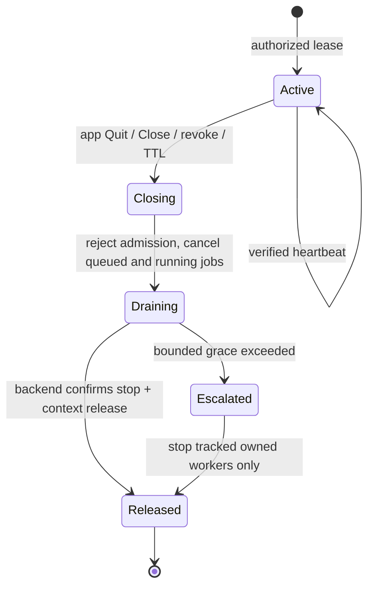

# Remote Compute v0.1: Typed Protocol / Contract (proposed)

**Status:** reviewed-design candidate and locally testable mock. No serialized wire format, real authenticated HTTPS or GPU runtime exists in this PR.

## Terminology and ID rules

`HostId`, `ClientId`, `AppId`, `ModelId`, `LeaseId`, `RequestId` are distinct Rust types. IDs are 1–128 ASCII characters from letters/digits/`_-.:`, start alphanumeric and disallow `..` to prevent path-like identifiers. Production should use cryptographically generated opaque IDs and host-issued globally unique request namespaces. Model identity is an immutable host registry ID + validated source/artifact digest/revision; **never a remote path**.

`ModelLocation::HostStored` references a PC-resolved model. `ClientStaged` requires host-attested consent, SHA-256, integrity and runtime compatibility before use. License, disk-space, retention and ownership validation remain unimplemented.

`PeerEvidence` contains claimed identities for the **verified TLS adapter boundary**: target host ID, pinned server certificate SHA-256, paired client device ID and pinned client cert, **separately attested app identity** (`AppAuthentication::VerifiedScopedCredential`), approved network route and security level. A paired Pi device certificate must not let one installed app impersonate another: a future ingress must verify a host-issued app-specific credential/token cryptographically. These fields cannot simply be copied from a network request into a trusted structure.

## Candidate control calls

| Call | Required authorization | Result / side effects |
| --- | --- | --- |
| Pair client (host-local admin) | Out-of-band user approval and cryptographic host/client identity verification | Certificate pin + pairing record, not an inference lease |
| Grant / revoke app (host-local admin) | Host owner; explicit device, app, model and task allowlist | Idempotent policy change; revoke cancels app's leases |
| OpenLease(client, app, model, lease) | Fresh mTLS identity + selected per-app grant + VRAM/lease budget | Lease TTL and model ref increment; first owned consumer loads model |
| Heartbeat(lease) | Same authenticated client+app identity | Extend its TTL only; cannot resurrect closing/expired lease |
| Submit(request ID, lease, task, payload metadata) | Same owner; active lease, allowed task and model | Queue under bounded payload size/concurrency/backpressure |
| Cancel(request ID) | Same owner | Queued cancel immediately; running cancel, bounded drain |
| CloseLease / CloseApp | Same owner | Cancel own jobs only; last-lease owned model unload |
| Tick / socket close | Host-local maintenance | Expire orphan leases, force **mock** timeout cleanup |
| Quit All owned services | Explicit host-owner authority, never exposed as ordinary app grant | Stop admission, drain all, protect independent providers |

`RequestId` replay returns the same in-memory job state only for the **same immutable request payload + client/app**. Conflicting reuse is rejected and cross-client attempts reveal no other client's contents. Real ingress must also bind the request to its original TLS session/authority, implement bounded/durable deduplication and retry/reconnect windows, and cap persisted metadata. Tests retain 10,000 request identities per mock instance and cap audit history at 1,024 entries; exceeding records fails closed instead of silently losing replay protection.

## Proposed future HTTPS surface (not implemented)

- `POST /v1/pair/confirm` — local-only host owner approval, short-lived single-use challenge.
- `GET /v1/hosts/{host_id}/models` — grant-filtered metadata; no paths or owner secrets.
- `POST /v1/leases` and `POST /v1/leases/{id}/heartbeat`.
- `POST /v1/jobs`, `GET /v1/jobs/{id}`, `POST /v1/jobs/{id}/cancel`.
- `DELETE /v1/leases/{id}` with idempotent release.
- `POST /v1/staging` — **separately approved** bounded encrypted transfer (not in mock).
- A documented safe subset of OpenAI-style chat/embeddings/transcription adapters may be added after compatibility tests; no unbounded tools/command execution.

Use structured versioned envelopes with request IDs, auth-bound app/client IDs, deadline, selected model ID, explicit input/output size limits, task kind and streaming sequence numbers. For streaming: bounded buffers, client backpressure, signed/verified origin, cancelled-terminal marker, no data leakage between sessions. Retries: dedup IDs, reject out-of-order completion, no hidden fallback to public cloud, explicit unavailable errors. Keep payloads and user prompts out of default audit trails. No mTLS secrets or full transcripts in logs.

### State transitions

The in-memory mock collapses some transitions to `Active → Closing → removed`; `JobStatus` tracks `Queued → Running → Cancelling → Cancelled` or terminal success/failure. Logical mock timeout does NOT imply a physical worker was killed. Host `Accepting → Draining → Drained` is independent of the GUI lifecycle.

## Adapter boundaries required before production

1. **Transport:** rustls/HTTPS host/peer verification, PKI or audited pin exchange, OS secure credential store, revocation/rotation, origin/CSRF/CORS and bind/firewall policy; mTLS `PeerEvidence` created inside authenticated transport only.
2. **Scheduler:** deadline-aware fair queues, global budgets, model compatibility per hardware/runtime, per-app quotas, cross-connection replay cache, persistence policy and reconnect semantics.
3. **Inference runtime:** cancellable tracked jobs, GPU/CPU/NPU model handle ownership, verified unload/release, no borrowed service kill, metrics with owner-attributable context accounting.
4. **Staging:** consent, SHA-256 over received bytes, supported artifact/license, encryption, quotas, atomic cache, own-temp-file cleanup and never remote arbitrary file paths.
5. **App adapters:** per-app grants, same-host use from Pi Advisor and App Agent, and support independent TIHULU clients without requiring GUI startup. An LLM result never grants tool execution rights.

Coordinators must align shared IDs/ownership types with `tihulu-ai-core` before wiring a production service; do not independently change coordinator-owned files.
