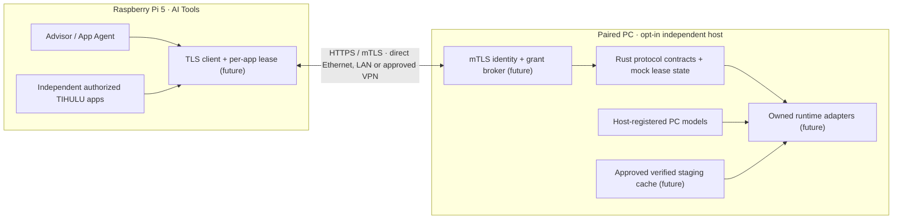

# Agent 04 — Paired GPU Host / Remote Compute

**Implementation:** prototype Rust contracts + in-memory mock only, 2026-11-12. **Product goal:** confirmed; TLS/HTTP endpoints, credential storage, runtime adapters, model transfers, actual GPU inference and release are **not implemented**. This agent edits only `crates/tihulu-ai-transport/**` and `docs/remote-compute/**`.

## Topology



The Pi's own Advisor and Agent can use a paired PC GPU, and independently authorized Text Center, Survival Kit, Media Center and other TIHULU apps can share that host. Authorization is **per paired device + app + model + task type**, with independent request and lease IDs and quotas. No remote caller gains arbitrary shell access, file access or authority to manage host processes. Windows, macOS Apple Silicon and Linux may eventually be host or clients subject to compatible runtimes. Pi 5 with Hailo AI HAT+ 2 remains a separate accelerator; Hailo HEF is not a CUDA artifact.

## Two model-placement modes

| Mode | Model location | Proof and behavior |
| --- | --- | --- |
| A — PC-stored | PC-installed/host-registered model ID | Host resolves model ID internally to an explicitly authorized asset/runtime. **No weights copied to Pi**. |
| B — Pi-stored / device-owned | Authoritative asset remains on Pi | Only after **explicit consent**, compatible format/license/runtime check, verified SHA-256, protected transfer and cache policy, a staged PC copy is registered by digest. No arbitrary Pi filesystem path is accepted as a model ID. |

The `ModelLocation` variants exist in Rust; **they do not transfer or verify real model bytes**. Hash/approval flags in the mock represent a future **host-attested** policy result and must never be accepted from a requester's JSON. Actual staging must be transactional, integrity-checked, quota-enforced and rollback-safe, with deletion of **owned temporary copies only**. Never delete a Pi/Jan/Ollama source asset on lease close. Never claim compatibility based solely on presence of a file or Hailo/CPU/RTX detection.

## Identity & transport boundary

- No listener starts on app launch; defaults are **OFF / On-Demand / Background OFF / no keep-warm**. Proposed loopback-only control server unless the owner explicitly enables a TLS-protected LAN service. Never expose bare low-level llama.cpp/GGML RPC to the Internet.
- Every remote call must run over HTTPS with **mutually authenticated TLS or an equivalent reviewed strong device-auth mechanism**, correct pinned host identity, device certificate rotation/revocation, strong CSPRNG pairing invitations, expiry and out-of-band user confirmation. Trust is **not** established merely by Ethernet, local IP, mDNS or a VPN connection.
- First-run pairing: host owner approves an on-screen fingerprint and selected client identity over an authenticated/out-of-band channel; store certificate keys/pins in platform secure storage. Pairing/credential generation, UI and persistent stores are **pending**.
- The in-memory `PairingApproval`, `PeerEvidence`, pinned fingerprint and `NetworkRoute` contracts are **mock assertions**, NOT secure TLS verification or cryptographic authentication. A future Axum/rustls transport must construct `PeerEvidence` from its verified session; reject client-supplied identity, TLS flags or staging proofs.
- Supported intended routes: direct PC↔Pi Ethernet, ordinary LAN and approved VPN; routing choice does not relax TLS. Refuse unapproved public-internet exposure. Host default bind disabled; approved firewall/bind/interface settings required.
- Client token/app grants must be issued and signed/validated server-side; no secrets in `aipath.txt`, log output, model IDs or URL query strings. Borrowed Jan/Ollama endpoints are never assumed authenticated without an explicit secure adapter.

## Shutdown and ownership — binding user requirement

One authenticated client/app acquires one or more model **leases** on the shared host. A request belongs immutably to its lease and cannot be cancelled by another app. Each lease has heartbeats and an expiry; owner-initiated Quit/Stop, credential revocation, socket close, host disconnect or TTL expiry moves it to `Closing`: reject new jobs, cancel queued work, signal running work, then await a **bounded graceful drain**. Mock `tick()` forces logical cancellation after the configured grace interval. **A real backend must actually terminate/join only its tracked app-owned worker and verify context release before calling the lease drained; the mock does not prove that.**

A host-owned loaded model is reference-counted across **all active and draining leases**. Its first authorized lease triggers one synthetic load; its last released lease triggers one synthetic unload and reduces **owner-attributable mock VRAM** to zero. Other models, active client jobs and the host process remain. A borrowed Jan/Ollama/runtime adapter must never be unloaded or killed by this system: its independent VRAM allocation is outside this host's ownership.

UI Quit releases only UI-owned leases. A separately enabled shared host remains on while other clients hold active leases. **Quit All TIHULU-Owned Services** is a distinct explicit host-owner operation with an impact warning and bounded drain; it never targets unrelated software, user Jan/Ollama, readsb/tar1090 or arbitrary processes by name.

The prototype implements the lifecycle state machine in memory, including expiring unresponsive clients, cancellation scopes, a guarded request-ID replay table, per-app limits, request-size and queue limits and safe late-completion behavior. It does **not** measure real GPU VRAM, free GPU contexts, cancel OS child processes or supervise a service. The real implementation must separately verify RAM/VRAM release with each selected inference runtime and preserve independent processes.

## Development

Standalone crate (no root workspace edits, no external dependencies):

```bash
cargo test --manifest-path crates/tihulu-ai-transport/Cargo.toml --all-targets
cargo fmt --manifest-path crates/tihulu-ai-transport/Cargo.toml --check
cargo clippy --manifest-path crates/tihulu-ai-transport/Cargo.toml --all-targets -- -D warnings
```

The crate deliberately declares its own `[workspace]`: the coordinator owns the root workspace and must later enroll it there as a separate reviewed change. **Not automatically exercised by root `cargo test --workspace` yet.** Physical Pi, Hailo, NVIDIA/RTX, macOS, Windows, Ethernet/VPN, certificate store and on-device RAM/VRAM acceptance are not included here.

UI copy target: **English default, Turkish and German**; connected/idle/draining and model ownership must remain clear across languages. UI is not implemented by Agent 04.

Related: [Protocol contract](PROTOCOL.md), [threat model](THREAT_MODEL.md), [validation](VALIDATION.md), [resource lifecycle](../RESOURCE_LIFECYCLE.md), [Agent 04 Issue](https://github.com/Tihulu/Tihulu-AI-Tools/issues/5).
